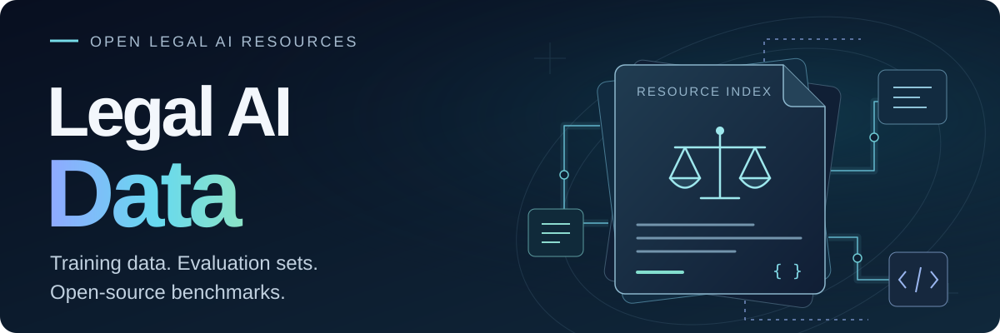

<p align="center">
  
</p>

<p align="center">
  <a href="#legal-agent-benchmarks"></a>
  <a href="#reference"></a>
  <a href="#legal-resources--skills"></a>
</p>

开源法律 AI 数据集与评测基准的整理，包括每个资源的数据结构、任务类型、评价方式和原始链接，另附相关法律资源与工具。

本项目持续更新。如果你正在开始一项研究、想复现某个工作，或只是想看看这个领域有哪些数据，希望这里能帮你省些时间。欢迎提 Issue 补充资源！

## Table of Contents

<details>
<summary>展开完整目录</summary>

- [Legal Agent Benchmarks](#legal-agent-benchmarks)
  - [LegalAgentBench](#legalagentbench)
  - [J1-Bench / J1-Eval](#j1-bench--j1-eval)
  - [MASER / MILE](#maser--mile)
  - [LEGALWORLD / LongJud-Bench](#legalworld--longjud-bench)
  - [DLawBench](#dlawbench)
  - [SimuCourt / AgentsCourt](#simucourt--agentscourt)
  - [Harvey LAB](#harvey-lab)
- [Reference](#reference)
  - [PLawBench](#plawbench)
  - [LegalBench](#legalbench)
  - [LawBench](#lawbench)
  - [LexEval](#lexeval)
  - [LAiW](#laiw)
  - [UCL-Bench](#ucl-bench)
  - [JuDGE](#judge)
  - [LegalBench-RAG](#legalbench-rag)
  - [LEVEN](#leven)
  - [LawShift](#lawshift)
  - [MUSER](#muser)
  - [LeCaRDv2](#lecardv2)
  - [LexChain](#lexchain)
  - [LexRel](#lexrel)
  - [MSLR-Bench](#mslr-bench)
  - [DISC-LawLLM](#disc-lawllm)
  - [LAW-GPT](#law-gpt)
  - [LawInstruct](#lawinstruct)
- [Legal Resources &amp; Skills](#legal-resources--skills)
  - [Laws](#laws)
  - [Legal-Skills-Chinese](#legal-skills-chinese)
- [General Observations](#general-observations)
- [License](#license)

</details>

收录口径：

- **Legal Agent Benchmarks**：明确评测法律智能体、交互式法律环境、工具调用、多角色协作或长流程法律任务。
- **Reference**：相关法律评测、训练资源及研究方法。
- **Legal Resources & Skills**：供模型或智能体使用的开源法律知识资源与技能。

License 列依据项目许可证文件及 README 声明填写；`-` 表示未找到明确许可声明。未单列数据许可时，不代表已确认所有附带数据均适用仓库许可证。

## Legal Agent Benchmarks

> 表格较宽，窄屏下可左右滚动查看。

<table>
  <thead>
    <tr>
      <th width="140" align="left">Benchmark</th>
      <th width="100" align="left">Region</th>
      <th width="210" align="left">Paper title</th>
      <th width="100" align="left">Links</th>
      <th width="230" align="left">数据规模<br>（数据量；任务类型数）</th>
      <th width="280" align="left">任务类型</th>
      <th width="190" align="left">法律领域</th>
      <th width="160" align="left">License</th>
    </tr>
  </thead>
  <tbody>
    <tr valign="top">
      <td>LegalAgent<br>Bench</td>
      <td>China /<br> Chinese</td>
      <td><em>LegalAgentBench:<br>Evaluating LLM Agents in<br>Legal Domain</em></td>
      <td><a href="https://github.com/CSHaitao/LegalAgentBench">GitHub</a>,<br> <a href="https://aclanthology.org/2025.acl-long.116/">ACL</a></td>
      <td>300条⁠具⁠体⁠数⁠据；<br>6 类⁠任⁠务⁠形⁠态（1-hop 至 5-hop 推⁠理、法⁠律⁠写⁠作）</td>
      <td>法⁠律⁠信⁠息⁠检⁠索、<br>工⁠具⁠调⁠用、<br>多⁠跳⁠法⁠律⁠推⁠理、<br>法⁠律⁠问⁠答、<br>法⁠律⁠写⁠作</td>
      <td>民⁠商⁠事/企⁠业⁠法⁠律、执⁠行、行⁠政⁠处⁠罚⁠等；<br>非⁠刑⁠事⁠为⁠主</td>
      <td><a href="https://github.com/CSHaitao/LegalAgentBench/blob/HEAD/README.md">MIT（README 声⁠明）</a></td>
    </tr>
    <tr valign="top">
      <td>J1-Bench /<br> J1-Eval</td>
      <td>China /<br> Chinese</td>
      <td><em>Ready Jurist One:<br>Benchmarking Language Agents<br>for Legal Intelligence in<br>Dynamic Environments</em></td>
      <td><a href="https://j1bench.github.io/">Project</a>,<br> <a href="https://github.com/FudanDISC/J1Bench">GitHub</a>,<br> <a href="https://arxiv.org/abs/2507.04037">Paper</a></td>
      <td>508 个 J1-Eval 样⁠本；<br>6 类⁠任⁠务</td>
      <td>法⁠律⁠知⁠识⁠问⁠答、<br>法⁠律⁠咨⁠询、<br>起⁠诉⁠状⁠生⁠成、<br>答⁠辩⁠状⁠生⁠成、<br>民⁠事⁠庭⁠审⁠交⁠互、<br>刑⁠事⁠庭⁠审⁠交⁠互</td>
      <td>民⁠事、刑⁠事</td>
      <td>-</td>
    </tr>
    <tr valign="top">
      <td>MASER /<br> MILE</td>
      <td>China /<br> Chinese</td>
      <td><em>Multi-Agent Simulator Drives<br>Language Models for Legal<br>Intensive Interaction</em></td>
      <td><a href="https://github.com/FudanDISC/MASER">GitHub</a>,<br> <a href="https://aclanthology.org/2025.findings-naacl.365/">Paper</a></td>
      <td>693 个 MILE 评⁠价⁠样⁠本；<br>1 类⁠核⁠心⁠任⁠务</td>
      <td>多⁠轮⁠法⁠律⁠咨⁠询、<br>客⁠户⁠事⁠实⁠询⁠问、<br>事⁠实⁠澄⁠清、<br>起⁠诉⁠状⁠生⁠成、<br>诉⁠讼⁠请⁠求/事⁠实⁠理⁠由/证⁠据⁠整⁠理</td>
      <td>民⁠事⁠为⁠主</td>
      <td>-</td>
    </tr>
    <tr valign="top">
      <td>LEGALWORLD /<br> LongJud-Bench</td>
      <td>China /<br> Chinese</td>
      <td><em>LEGALWORLD:<br>A Life-Cycle Interactive<br>Environment for Legal Agents</em></td>
      <td><a href="https://chidaic.github.io/Legal-world/">Project</a>,<br> <a href="https://github.com/chidaic/Legal-world">GitHub</a>,<br> <a href="https://arxiv.org/abs/2606.18728">Paper</a></td>
      <td>75,309 对⁠一⁠审/二⁠审⁠案⁠件；<br>7 个⁠场⁠景/任⁠务⁠模⁠块</td>
      <td>法⁠律⁠咨⁠询、<br>文⁠书⁠起⁠草、<br>一⁠审⁠庭⁠审、<br>上⁠诉⁠判⁠断、<br>上⁠诉⁠文⁠书⁠起⁠草、<br>二⁠审⁠庭⁠审</td>
      <td>民⁠事⁠诉⁠讼</td>
      <td>-</td>
    </tr>
    <tr valign="top">
      <td>DLawBench</td>
      <td>China + U.S. /<br> Chinese + English</td>
      <td><em>DLawBench:<br>bilingual multi-turn legal<br>consultation benchmark</em></td>
      <td><a href="https://github.com/SKYLENAGE-AI/DLawBench">GitHub</a></td>
      <td>461 个⁠报⁠告⁠案⁠件；<br>1 类⁠核⁠心⁠任⁠务、4 种 client persona；<br>本⁠地⁠公⁠开⁠子⁠集 60 个⁠案⁠件</td>
      <td>多⁠轮⁠法⁠律⁠咨⁠询、<br>追⁠问⁠与⁠事⁠实⁠调⁠查、<br>争⁠议⁠事⁠实⁠澄⁠清、<br>法⁠律⁠问⁠题⁠识⁠别、<br>法⁠律 memo 生⁠成</td>
      <td>民⁠事、商⁠事、刑⁠事、行⁠政⁠等⁠多⁠领⁠域</td>
      <td>代⁠码：<a href="https://github.com/SKYLENAGE-AI/DLawBench/blob/HEAD/LICENSE">MIT</a>；<br>数⁠据：<a href="https://github.com/SKYLENAGE-AI/DLawBench/blob/HEAD/data/LICENSE">CC BY 4.0</a></td>
    </tr>
    <tr valign="top">
      <td>SimuCourt /<br> AgentsCourt</td>
      <td>China /<br> Chinese</td>
      <td><em>AgentsCourt:<br>Building Judicial<br>Decision-Making Agents with<br>Court Debate Simulation and<br>Legal Knowledge Augmentation</em></td>
      <td><a href="https://arxiv.org/abs/2403.02959">Paper</a></td>
      <td>本⁠地 419 份⁠裁⁠判⁠文⁠书（一⁠审 239、二⁠审 180）；<br>1 类⁠核⁠心⁠任⁠务</td>
      <td>庭⁠审⁠辩⁠论⁠模⁠拟、<br>事⁠实⁠认⁠定、<br>法⁠律⁠知⁠识⁠运⁠用、<br>司⁠法⁠决⁠策、<br>罪⁠名/案⁠由⁠预⁠测、<br>刑⁠期⁠和⁠罚⁠金⁠预⁠测</td>
      <td>民⁠事、刑⁠事、行⁠政⁠司⁠法⁠裁⁠判</td>
      <td>-</td>
    </tr>
    <tr valign="top">
      <td>Harvey LAB</td>
      <td>Foreign /<br> English</td>
      <td><em>Legal Agent Benchmark (LAB):<br>An open-source benchmark for<br>evaluating agents on real<br>legal work</em></td>
      <td><a href="https://github.com/harveyai/harvey-labs">GitHub</a>,<br> <a href="https://www.harvey.ai/blog/introducing-harveys-legal-agent-benchmark">Announcement</a></td>
      <td>1,700+ 个⁠任⁠务；<br>25 个⁠业⁠务⁠领⁠域⁠目⁠录</td>
      <td>合⁠同⁠审⁠查、<br>条⁠款⁠提⁠取、<br>尽⁠职⁠调⁠查、<br>法⁠律⁠研⁠究、<br>备⁠忘⁠录⁠生⁠成、<br>文⁠件⁠比⁠较、<br>交⁠易⁠文⁠书⁠起⁠草、<br>诉⁠讼/监⁠管⁠任⁠务⁠处⁠理</td>
      <td>商⁠事、交⁠易、诉⁠讼、监⁠管、税⁠务、知⁠识⁠产⁠权⁠等；<br>含⁠白⁠领⁠犯⁠罪/调⁠查</td>
      <td><a href="https://github.com/harveyai/harvey-labs/blob/HEAD/LICENSE">MIT</a></td>
    </tr>
  </tbody>
</table>

### LegalAgentBench

- **数据结构**：

```json
{
  "id": 1,
  "question": "我在进行一起涉及金宏气体股份有限公司的商业案件调查，想要了解该上市公司的代码、法人代表以及董秘的详细信息。",
  "answer": "金宏气体股份有限公司的股票代码是688106，法人代表是金向华，董秘是陈莹。",
  "key": ["688106", "金向华", "陈莹"],
  "key_middle": [],
  "type": "1-1",
  "way": "get_company_info"
}
```

- **评价方式**：主要有 `key_answer`、`key_middle` 和 `bertscore` 三种模式。`key_answer` 计算最终回答命中的标准答案关键词比例，`key_middle` 进一步纳入中间步骤关键词，`bertscore` 比较模型答案和参考答案的语义 F1；整体偏客观匹配和语义相似度评价，不依赖 LLM judge。

### J1-Bench / J1-Eval

- **数据结构**：

```json
{
  "J1-Eval_KQ.jsonl": {
    "count": 98,
    "sample": {
      "id": "KQ-1",
      "category": "实体 民事权利纠纷",
      "roles": {
        "legal_agent": "房地产律师",
        "general_public": {
          "occupation": "小区业主",
          "big-5_traits": {
            "外向性": "中",
            "神经质": "低"
          }
        }
      },
      "topic_list": [
        {
          "topic": "经过规划的小区车位归谁所有？",
          "content": "小区道路上规划用于停放汽车的车位，属于开发商。",
          "type": "open-ended_long_context"
        }
      ],
      "theme": "小区车位归属问题"
    }
  },
  "J1-Eval_LC.jsonl": {
    "count": 62,
    "sample": {
      "id": "LC-1",
      "category": "实体 家事纠纷",
      "roles": {
        "general_public": {
          "role": "男方",
          "background": "妻子怀孕后单方面终止妊娠，男方主张生育权受到侵犯。"
        }
      },
      "topic_list": [
        {
          "topic": "女方单方面终止妊娠是否构成对男方生育权的侵犯？",
          "content": "否",
          "type": "binary"
        }
      ]
    }
  },
  "J1-Eval_CD.jsonl": {
    "count": 93,
    "sample": {
      "id": "CD-1",
      "category": "人格权纠纷",
      "specific_characters": {
        "plaintiff": {
          "name": "于英雪",
          "gender": "女"
        },
        "defendant": {
          "name": "王美珠",
          "gender": "女"
        }
      },
      "claims": ["被告赔偿原告人身损害赔偿金14096.39元"],
      "case_details": "原告在小区售卖水果时与被告发生争执，主张被告致其胸部外伤、腰部扭伤。",
      "evidence": {
        "evidence_1": {
          "evidence": "原告住院病历、诊断书、医疗费收据",
          "dispute": ""
        }
      }
    }
  },
  "J1-Eval_DD.jsonl": {
    "count": 93,
    "sample_fields": ["id", "category", "specific_characters", "plaintiff_claim", "plaintiff_case_details", "court_info", "statement_of_defence", "evidence"]
  },
  "J1-Eval_CI.jsonl": {
    "count": 93,
    "sample_fields": ["id", "category", "specific_characters", "plaintiff_claim", "plaintiff_case_details", "defendant_defence", "evidence", "other_statement", "court_information"]
  },
  "J1-Eval_CR.jsonl": {
    "count": 69,
    "sample_fields": ["id", "category", "defendant", "lawyer", "procurator", "court_information"]
  }
}
```

- **评价方式**：J1 按场景分别计分，而不是使用单一统一指标。

| 场景 | 含义                                     | 主要得分项                                                                       | 客观/规则评分                                                                                     | LLM 评分                                                                 |
| ---- | ---------------------------------------- | -------------------------------------------------------------------------------- | ------------------------------------------------------------------------------------------------- | ------------------------------------------------------------------------ |
| KQ   | Legal Knowledge QA，法律知识问答         | `BIN`、`NBIN`、`AVE`                                                       | 二分类题准确率；法条名称和条文号命中                                                              | 开放式长答案按 0-10 分评分后归一化                                       |
| LC   | Legal Consultation，法律咨询             | `BIN`、`NBIN`、`AVE`                                                       | 二分类题准确率；法条名称和条文号命中                                                              | 开放式咨询回答按 0-10 分评分后归一化                                     |
| CD   | Complaint Drafting，起诉状生成           | `PLA`、`DEF`、`CLA`、`EVI`、`FAC`、`FOR`、`AVE`                    | 原告/被告身份信息字段匹配；文书标题和顺序检查；格式遵循`FOR`                                    | 诉讼请求`CLA`、证据 `EVI`、事实与理由 `FAC` 按 0-10 分评分后归一化 |
| DD   | Defense Drafting，答辩状生成             | `RES/DEFEN`、`DEF/DEFENSE`、`EVI`、`FOR`、`AVE`                        | 被告/答辩人信息字段匹配；格式标题和顺序检查；格式遵循`FOR`                                      | 答辩意见`DEF/DEFENSE`、证据 `EVI` 按 0-10 分评分后归一化             |
| CI   | Civil Court Interaction，民事庭审交互    | `PFS`、`UNI`、`STA`、`ACT`、`REA`、`LAW`、`JUD/VER`                | `UNI` 对话成立性；`STA` 庭审阶段完整性；`ACT` 程序动作覆盖；`LAW` 法条命中                | `REA` 法律说理质量；`JUD/VER` 判决结果一致性/裁判质量                |
| CR   | Criminal Court Interaction，刑事庭审交互 | `PFS`、`UNI`、`STA`、`ACT`、`CRI`、`SEN`、`FINE`、`REA`、`LAW` | `UNI/STA/ACT` 流程规则；`CRI` 罪名匹配；`SEN` 刑期差距；`FINE` 罚金差距；`LAW` 法条命中 | `REA` 裁判理由/法律说理质量                                            |

结构化内容，如二分类答案、当事人信息、程序动作、法条、罪名、刑期和罚金，主要通过规则匹配或数值计算评价；开放式内容，如长答案、法律说理、文书质量和庭审发言，则主要由 LLM-as-judge 按 0-10 分评分后归一化。

### MASER / MILE

- **数据结构**：

```json
{
  "id": 1,
  "case_r_f": "李恩泉与冯伟之前系同事关系，二被告是夫妻关系。自2011年开始，二被告因业务周转等理由陆续向李恩泉借款。",
  "reason": "双方形成民间借贷关系，被告未按约履行偿还义务，应承担违约责任。",
  "laws": "《中华人民共和国合同法》第六十条、第一百零七条",
  "plaintiff_type": "personal",
  "plaintiff": "身份：原告，姓名：李恩泉，性别：男，出生日期：1970年3月17日，民族：汉族，地址：西虹市历下区。",
  "law_level": "了解简单法律常识，知道基本法律词汇，但不理解具体含义。",
  "personality": "内向、情绪不稳定、开放、不太宜人、尽责。",
  "speak_style": {
    "tone": "说话语气较为柔和，但时常带有紧张和不确定感。",
    "interaction": "更多回应律师提问，不太主动提问。"
  },
  "less": "出生日期",
  "defendant": "身份：被告1，姓名：冯伟；身份：被告2，姓名：孙一海。",
  "claim": {
    "非诉讼费用内容": "请求两被告偿还借款本金538720元及利息。",
    "诉讼费用内容": "请求诉讼费由两被告承担。"
  },
  "evidence": {
    "原告": ["2013年及2017年两份由被告出具的借条", "转账记录"]
  },
  "output": "起诉状"
}
```

- **评价方式**：MILE 分为 Interaction 和 Goal 两部分。Interaction 对律师回复按 `互动性`、`专业性`、`逻辑性` 三项评分，每项 0-10，属于 LLM 评价；Goal 主要评估最终法律文书中的原被告信息、诉讼请求、事实与理由、证据、模板规范性和专业性。

### LEGALWORLD / LongJud-Bench

- **数据结构**：

```json
{
  "original_id": 1,
  "extracted_info": {
    "case_background": "马忠民与穆维好于2012年8月20日签订《合作开发房地产合同书》，约定共同投资开发尚东国际小区项目。",
    "party_info": {
      "plaintiff": {
        "name": "马忠民",
        "type": "自然人",
        "legal_persona_profile": {
          "legal_literacy_level": "低",
          "information_disclosure_willingness": "中",
          "emotional_stability": "中",
          "narrative_proficiency": "中"
        },
        "questions": [
          {
            "question": "我2012年投了1000万，他们只还了200万，剩下的钱还能要回来吗？",
            "reference_answer": "该款项被认定为借款而非投资款，已还200万元可从本金中扣除，剩余800万元本金有权要求返还。"
          }
        ]
      },
      "defendant": {
        "name": "青海三兴房地产开发有限公司",
        "type": "法人",
        "legal_persona_profile": {
          "legal_literacy_level": "中",
          "information_disclosure_willingness": "中",
          "emotional_stability": "中",
          "narrative_proficiency": "中"
        },
        "questions": [
          {
            "question": "我们2018年还他那200万，能直接算进1000万里扣掉吗？",
            "reference_answer": "可以，该200万元属于偿还借款，应从本金中扣除。"
          }
        ]
      }
    },
    "appellant": "原告",
    "first_instance": {
      "court": "青海省高级人民法院",
      "case_number": "（2018）青民初65号",
      "final_judgment": "被告返还借款本金并支付相应利息。"
    },
    "second_instance": {
      "court": "最高人民法院",
      "case_number": "（2019）最高法民终字样例",
      "final_judgment": "维持或调整一审关于本金及利息的认定。"
    },
    "case_cause": "民间借贷纠纷"
  }
}
```

- **评价方式**：LEGALWORLD 按诉讼生命周期阶段评价：`LC`（Legal Consultation，法律咨询）权重 10；`CD`（Complaint Drafting，起诉状起草）和 `DD`（Defense Drafting，答辩状起草）各权重 15；`CI`（Civil Investigation，民事一审庭审）权重 30；`AD`（Appeal Drafting，上诉状起草）和 `AR`（Appeal Response，上诉答辩状起草）各权重 15；`CIA`（Civil Investigation Appeal，民事二审庭审）权重 30。评价维度包括咨询问答质量，起诉状/答辩状/上诉状中的诉讼请求、事实与理由和证据，以及一审/二审庭审中的主张一致性、事实证据运用完整性和法律说理充分性；开放式内容主要由 LLM judge 按 0-10 分档评分。

### DLawBench

- **数据结构**：

```json
{
  "id": "case_cn_0001",
  "jurisdiction": "CN",
  "language": "zh",
  "opening": "律师你好，我是张某，之前电话里跟您说过，我出了交通事故被追究刑事责任的事，想请您帮我看看。",
  "facts": [
    {
      "fact_id": "F1",
      "client_belief": "2024年6月20日晚上7点多，我开着重型货车逆向行驶，跟对面超速开过来的轻型货车撞了。",
      "court_record": "张某驾驶严重超载的重型自卸货车逆向行驶，与王某驾驶的超速轻型栏板货车发生碰撞。",
      "gap_type": "undisputed"
    }
  ],
  "evaluation_criteria": {
    "expected_inquiries": ["追问事故发生时车辆是否超载、是否疲劳驾驶、有无使用手机等影响注意力的行为。"],
    "memo_expectations": ["交通肇事罪入罪标准明确，辩护重点应放在量刑情节而非无罪辩护。"]
  },
  "sha256": "4b14b14ef5543c11dbef946baddefef32c1d3ffd1c0a8e9d5a64ee905d10f3b2"
}
```

- **评价方式**：DLawBench 输出 `Fact Coverage`、`Inquiry`、`Elicitation`、`Fact Resolution`、`Issue Resolution`、`Resolution` 和 `Fidelity`。其中 Fact Coverage 看关键事实覆盖，Inquiry 看是否问到预期问题，Fact Resolution 看事实判断准确性，Issue Resolution 看法律问题是否解决，Fidelity 看最终 memo 是否被对话和案卷事实支持；评价结合 rubric、LLM judge 和指标聚合。

### SimuCourt / AgentsCourt

- **数据结构**：

```json
{
  "SimuCourt(1).json": {
    "count": 239,
    "category_distribution": {
      "刑事": 80,
      "行政": 80,
      "民事": 79
    },
    "sample": {
      "序号": 1,
      "案件名": "杨某危险驾驶罪一审刑事判决书",
      "类别": "刑事",
      "法院": "上海市浦东新区人民法院",
      "法院层级": "基层",
      "案由": "危险驾驶",
      "案号": "（2023）沪0115刑初3716号",
      "审理程序": "一审",
      "原告（公诉）": "上海市浦东新区人民检察院",
      "被告": "杨某",
      "基本案情": "被告人因危险驾驶被提起公诉。",
      "法院意见": "法院根据查明事实和相关法律作出裁判。",
      "引用法律条文1": "刑法相关条款",
      "刑事_罪名": "危险驾驶罪",
      "刑事_刑期": "拘役",
      "刑事_罚金": "罚金"
    }
  },
  "SimuCourt(2).json": {
    "count": 180,
    "category_distribution": {
      "刑事": 60,
      "民事": 60,
      "行政": 60
    },
    "sample": {
      "序号": 1,
      "案件名": "李文胜危险驾驶罪刑事二审刑事判决书",
      "类别": "刑事",
      "法院": "甘肃省定西市中级人民法院",
      "案由": "危险驾驶",
      "案号": "（2022）甘11刑终177号",
      "审理程序": "二审",
      "上诉人": "（原审被告人）李文胜",
      "上诉请求": "一审量刑过重，请求改判缓刑",
      "一审法院认定事实": "一审法院查明的事实",
      "二审意见": "二审法院围绕上诉理由和一审裁判进行审查",
      "刑事_罪名": "危险驾驶罪",
      "刑事_刑期": "刑期结果",
      "刑事_罚金": "罚金结果"
    }
  },
  "laws_1/2/3.json": {
    "type": "法律知识库",
    "structure": {
      "第一条": {
        "第一条": "法律条文内容"
      },
      "第二条": {
        "第二条第一款": "分款条文内容"
      }
    }
  }
}
```

- **评价方式**：庭审辩论是生成裁判前的模拟流程，公开评估脚本主要衡量最终裁判结果和法律依据是否正确。法律依据使用法条 Precision、Recall、F1 评价；刑事案件评估罪名、刑期、罚金是否与真实判决一致；民事和行政案件通过 GPT-4 比较生成裁判结果与标准答案的信息点匹配度和准确性，并计算 P/R/F1。公开脚本没有单独给出“庭审辩论质量”分数。

### Harvey LAB

- **数据结构**：

```json
{
  "title": "Credit Agreement Financial Covenant Extraction Memorandum for Acquisition Due Diligence",
  "work_type": "analyze",
  "tags": ["credit-agreements", "financial-covenants", "M&A", "due-diligence"],
  "instructions": "Extract and compare all financial covenants across the attached credit agreements and related documents.",
  "criteria": [
    {
      "id": "C-001",
      "title": "First Lien EBITDA definition includes standard add-backs.",
      "deliverables": ["financial-covenant-extraction-memo.docx"],
      "match_criteria": "PASS if the memo identifies Net Income + Interest Expense + Taxes + D&A + Stock-Based Compensation."
    }
  ],
  "deliverables": {
    "financial-covenant-extraction-memo.docx": "financial-covenant-extraction-memo.docx"
  },
  "documents": ["credit-agreement.docx", "lender-email.eml", "financial-summary.xlsx"]
}
```

- **评价方式**：每个 `task.json` 的 `criteria` 都是独立的 pass/fail 条件，由 LLM judge 根据指定 deliverable 判断是否通过。任务采用 all-pass 规则：只有全部 criteria 通过才得 1.0，否则得 0；报告同时展示通过的 criteria 数量、失败项和按任务/领域/模型的汇总结果。

## Reference

> 表格较宽，窄屏下可左右滚动查看。

<table>
  <thead>
    <tr>
      <th width="140" align="left">Project / Dataset</th>
      <th width="100" align="left">Region</th>
      <th width="210" align="left">Paper title</th>
      <th width="100" align="left">Links</th>
      <th width="230" align="left">Data size<br>（examples; tasks/files）</th>
      <th width="280" align="left">任务类型</th>
      <th width="190" align="left">法律领域</th>
      <th width="160" align="left">License</th>
    </tr>
  </thead>
  <tbody>
    <tr valign="top">
      <td>PLawBench</td>
      <td>China /<br> Chinese</td>
      <td><em>PLawBench:<br>A Rubric-Based Benchmark for<br>Evaluating LLMs in Real-World<br>Legal Practice</em></td>
      <td><a href="https://github.com/SKYLENAGE-AI/PLawbench">GitHub</a></td>
      <td>280 examples: 250 case analysis, 18 consultation, 6 complaint, 6 defense</td>
      <td>案⁠例⁠分⁠析；<br>法⁠律⁠咨⁠询；<br>起⁠诉⁠状⁠与⁠答⁠辩⁠状⁠起⁠草</td>
      <td>民⁠事/家⁠事/劳⁠动/商⁠事⁠为⁠主</td>
      <td>-</td>
    </tr>
    <tr valign="top">
      <td>LegalBench</td>
      <td>U.S. /<br> English</td>
      <td><em>LegalBench:<br>A Collaboratively Built<br>Benchmark for Measuring Legal<br>Reasoning in Large Language<br>Models</em></td>
      <td><a href="https://github.com/HazyResearch/legalbench">GitHub</a></td>
      <td>11,075 parsed examples;<br> 162 tasks</td>
      <td>合⁠同⁠理⁠解；<br>法⁠律⁠推⁠理；<br>判⁠例、<br>隐⁠私⁠政⁠策⁠与⁠法⁠律⁠规⁠则⁠任⁠务</td>
      <td>民⁠商⁠事/合⁠规/综⁠合</td>
      <td><a href="https://github.com/HazyResearch/legalbench/tree/HEAD/tasks">按⁠各⁠子⁠数⁠据⁠集⁠许⁠可</a></td>
    </tr>
    <tr valign="top">
      <td>LawBench</td>
      <td>China /<br> Chinese</td>
      <td><em>LawBench:<br>Benchmarking Legal Knowledge<br>of Large Language Models</em></td>
      <td><a href="https://github.com/open-compass/LawBench">GitHub</a></td>
      <td>20 tasks;<br> 10,000 examples in zero-shot and 10,000 in one-shot</td>
      <td>法⁠律⁠知⁠识⁠记⁠忆；<br>法⁠律⁠理⁠解；<br>法⁠律⁠推⁠理；<br>法⁠律⁠应⁠用</td>
      <td>民⁠事/刑⁠事/行⁠政/综⁠合</td>
      <td>代⁠码：<a href="https://github.com/open-compass/LawBench/blob/HEAD/LICENSE">Apache-2.0</a>；<br>数⁠据：<a href="https://github.com/open-compass/LawBench/blob/HEAD/README_EN.md#licenses">遵⁠循⁠原⁠始⁠数⁠据⁠集⁠许⁠可</a></td>
    </tr>
    <tr valign="top">
      <td>LexEval</td>
      <td>China /<br> Chinese</td>
      <td><em>LexEval:<br>A Comprehensive Chinese Legal<br>Benchmark for Evaluating<br>Large Language Models</em></td>
      <td><a href="https://github.com/CSHaitao/LexEval">GitHub</a></td>
      <td>14,150 questions;<br> 23 tasks</td>
      <td>法⁠律⁠记⁠忆；<br>法⁠律⁠理⁠解；<br>逻⁠辑⁠推⁠理；<br>法⁠律⁠辨⁠别；<br>法⁠律⁠生⁠成；<br>法⁠律⁠伦⁠理</td>
      <td>民⁠事/刑⁠事/行⁠政/商⁠事⁠综⁠合</td>
      <td><a href="https://github.com/CSHaitao/LexEval/blob/HEAD/LICENSE">MIT</a></td>
    </tr>
    <tr valign="top">
      <td>LAiW</td>
      <td>China /<br> Chinese</td>
      <td><em>LAiW:<br>A Chinese Legal Large<br>Language Models Benchmark</em></td>
      <td><a href="https://github.com/Dai-shen/LAiW">GitHub</a></td>
      <td>11,605 examples;<br> 14 tasks</td>
      <td>基⁠础⁠信⁠息⁠检⁠索；<br>法⁠律⁠原⁠则⁠推⁠理；<br>法⁠律⁠高⁠级⁠应⁠用</td>
      <td>民⁠事/刑⁠事/行⁠政⁠综⁠合</td>
      <td><a href="https://github.com/Dai-shen/LAiW/blob/HEAD/LICENSE">MIT</a></td>
    </tr>
    <tr valign="top">
      <td>UCL-Bench</td>
      <td>China /<br> Chinese</td>
      <td><em>UCL-Bench:<br>A Chinese User-Centric Legal<br>Benchmark for Large Language<br>Models</em></td>
      <td><a href="https://aclanthology.org/2025.findings-naacl.444/">ACL</a>,<br> <a href="https://github.com/wittenberg11/UCL-bench">GitHub</a></td>
      <td>230 public examples;<br> 23 tasks</td>
      <td>用⁠户⁠模⁠拟；<br>法⁠律⁠咨⁠询；<br>罪⁠名/法⁠条⁠预⁠测；<br>文⁠书⁠与⁠案⁠件⁠任⁠务</td>
      <td>民⁠事/刑⁠事/行⁠政⁠综⁠合</td>
      <td><a href="https://github.com/wittenberg11/UCL-bench/blob/HEAD/LICENSE">MIT</a></td>
    </tr>
    <tr valign="top">
      <td>JuDGE</td>
      <td>China /<br> Chinese</td>
      <td><em>JuDGE:<br>Benchmarking Judgment<br>Document Generation for<br>Chinese Legal System</em></td>
      <td><a href="https://github.com/oneal2000/JuDGE">GitHub</a>,<br> <a href="https://arxiv.org/abs/2503.14258">Paper</a></td>
      <td>2,505 cases;<br> 452 law articles;<br> 2,505 case-corpus records</td>
      <td>裁⁠判⁠文⁠书⁠生⁠成；<br>法⁠律⁠说⁠理；<br>裁⁠判⁠结⁠果⁠预⁠测；<br>类⁠案/法⁠条⁠检⁠索</td>
      <td>刑⁠事⁠为⁠主</td>
      <td><a href="https://github.com/oneal2000/JuDGE/blob/HEAD/LICENSE">MIT</a></td>
    </tr>
    <tr valign="top">
      <td>LegalBench-RAG</td>
      <td>Foreign /<br> English</td>
      <td><em>LegalBench-RAG:<br>A Benchmark for<br>Retrieval-Augmented<br>Generation in the Legal<br>Domain</em></td>
      <td><a href="https://github.com/zeroentropy-ai/legalbenchrag">GitHub</a>,<br> <a href="https://arxiv.org/abs/2408.10343">Paper</a></td>
      <td>6,889 tests;<br> 714 corpus text files;<br> 4 benchmark datasets</td>
      <td>检⁠索⁠问⁠答；<br>证⁠据⁠片⁠段⁠定⁠位；<br>基⁠于⁠引⁠用⁠的⁠答⁠案⁠生⁠成</td>
      <td>民⁠商⁠事/合⁠同/隐⁠私⁠合⁠规</td>
      <td>代⁠码：<a href="https://github.com/zeroentropy-ai/legalbenchrag/blob/HEAD/LICENSE">MIT</a>；<br>数⁠据：<a href="https://github.com/zeroentropy-ai/legalbenchrag/blob/HEAD/README.md#usage">遵⁠循⁠原⁠始⁠数⁠据⁠集⁠使⁠用⁠条⁠款</a></td>
    </tr>
    <tr valign="top">
      <td>LEVEN</td>
      <td>China /<br> Chinese</td>
      <td>LEVEN:<br>A Large-Scale Chinese Legal<br>Event Detection Dataset</td>
      <td><a href="https://github.com/thunlp/LEVEN">GitHub</a></td>
      <td>本⁠地 8,116 份⁠文⁠书：训⁠练 5,301、验⁠证 1,230、测⁠试 1,585；<br>108 类⁠事⁠件</td>
      <td>法⁠律⁠事⁠件⁠检⁠测；<br>事⁠件⁠触⁠发⁠词⁠识⁠别</td>
      <td>刑⁠事</td>
      <td>-</td>
    </tr>
    <tr valign="top">
      <td>LawShift</td>
      <td>China /<br> Chinese</td>
      <td>LawShift:<br>Benchmarking Legal Judgment<br>Prediction Under Statute<br>Shifts</td>
      <td><a href="https://huggingface.co/datasets/triangularPeach/LawShift">Dataset</a></td>
      <td>本⁠地⁠训⁠练 251,883、验⁠证 63,007；<br>31 类⁠法⁠条⁠修⁠改⁠测⁠试⁠目⁠录</td>
      <td>法⁠条⁠变⁠动⁠下⁠的⁠罪⁠名、<br>法⁠条⁠及⁠刑⁠期⁠预⁠测</td>
      <td>刑⁠事</td>
      <td><a href="https://huggingface.co/datasets/triangularPeach/LawShift/blob/main/README.md">Apache-2.0</a></td>
    </tr>
    <tr valign="top">
      <td>MUSER</td>
      <td>China /<br> Chinese</td>
      <td>MUSER:<br>A Multi-View Similar Case<br>Retrieval Dataset</td>
      <td><a href="https://github.com/THUlawtech/MUSER">GitHub</a></td>
      <td>100 个⁠查⁠询；<br>本⁠地⁠案⁠例⁠池 4,024 条；<br>3 类⁠法⁠律⁠要⁠素⁠视⁠角</td>
      <td>类⁠案⁠检⁠索；<br>法⁠律⁠要⁠素⁠预⁠测</td>
      <td>民⁠事</td>
      <td><a href="https://github.com/THUlawtech/MUSER/blob/HEAD/LICENSE">MIT</a></td>
    </tr>
    <tr valign="top">
      <td>LeCaRDv2</td>
      <td>China /<br> Chinese</td>
      <td>LeCaRDv2:<br>A Large-Scale Chinese Legal<br>Case Retrieval Dataset</td>
      <td><a href="https://github.com/THUIR/LeCaRDv2">GitHub</a></td>
      <td>800 个⁠查⁠询；<br>项⁠目⁠报⁠告 55,192 个⁠候⁠选⁠案⁠例</td>
      <td>类⁠案⁠检⁠索；<br>相⁠关⁠性⁠排⁠序</td>
      <td>刑⁠事</td>
      <td><a href="https://github.com/THUIR/LeCaRDv2/blob/HEAD/LICENSE">MIT</a></td>
    </tr>
    <tr valign="top">
      <td>LexChain</td>
      <td>China /<br> Chinese</td>
      <td>LexChain:<br>Modeling Legal Reasoning<br>Chains for Chinese Tort Case<br>Analysis</td>
      <td><a href="https://github.com/thunlp/LexChain">GitHub</a>,<br> <a href="https://huggingface.co/datasets/TsinghuaNLP/LexChain">Dataset</a></td>
      <td>本⁠地 1,000 对⁠评⁠测⁠输⁠入⁠与⁠参⁠考⁠结⁠果；<br>另⁠附⁠训⁠练⁠文⁠件</td>
      <td>法⁠律⁠要⁠素⁠识⁠别；<br>责⁠任⁠划⁠分；<br>损⁠害⁠赔⁠偿⁠计⁠算；<br>裁⁠判⁠归⁠纳</td>
      <td>民⁠事⁠侵⁠权</td>
      <td>-</td>
    </tr>
    <tr valign="top">
      <td>LexRel</td>
      <td>China /<br> Chinese</td>
      <td>LexRel:<br>Benchmarking Legal Relation<br>Extraction for Chinese Civil<br>Cases</td>
      <td><a href="https://github.com/thunlp/LexRel">GitHub</a></td>
      <td>训⁠练 R1 19,798、4o 17,706；<br>测⁠试 1,140；<br>106 类⁠法⁠律⁠关⁠系</td>
      <td>法⁠律⁠关⁠系⁠及⁠主⁠体、<br>客⁠体、<br>权⁠利⁠义⁠务⁠抽⁠取</td>
      <td>民⁠事</td>
      <td>-</td>
    </tr>
    <tr valign="top">
      <td>MSLR-Bench</td>
      <td>China /<br> Chinese</td>
      <td>Benchmarking Multi-Step Legal<br>Reasoning and Analyzing<br>Chain-of-Thought Effects in<br>Large Language Models</td>
      <td><a href="https://github.com/yuwenhan07/MSLR-Bench">GitHub</a></td>
      <td>本⁠地 1,389 条⁠输⁠入⁠及⁠对⁠应⁠结⁠构⁠化⁠文⁠件；<br>2 类⁠核⁠心⁠任⁠务</td>
      <td>结⁠构⁠化⁠信⁠息⁠抽⁠取；<br>案⁠件⁠分⁠析⁠与⁠裁⁠判⁠预⁠测</td>
      <td>证⁠券；<br>内⁠幕⁠交⁠易；<br>行⁠政⁠及⁠刑⁠事</td>
      <td><a href="https://github.com/yuwenhan07/MSLR-Bench/blob/HEAD/LICENSE">Apache-2.0</a></td>
    </tr>
    <tr valign="top">
      <td>DISC-LawLLM</td>
      <td>China /<br> Chinese</td>
      <td>DISC-LawLLM:<br>Fine-tuning Large Language<br>Models for Intelligent Legal<br>Services</td>
      <td><a href="https://github.com/FudanDISC/DISC-LawLLM">GitHub</a>,<br> <a href="https://huggingface.co/datasets/ShengbinYue/DISC-Law-SFT">Dataset</a></td>
      <td>本⁠地 4 个 SFT 文⁠件，分⁠别⁠为 166,758 / 79,692 / 16,000 / 23,331 条；<br>另⁠含⁠评⁠测⁠集</td>
      <td>指⁠令⁠微⁠调；<br>法⁠律⁠问⁠答；<br>知⁠识⁠增⁠强；<br>配⁠套⁠法⁠律⁠评⁠测</td>
      <td>综⁠合</td>
      <td>代⁠码：<a href="https://github.com/FudanDISC/DISC-LawLLM/blob/HEAD/LICENSE">Apache-2.0</a>；<br>SFT 数⁠据：<a href="https://huggingface.co/datasets/ShengbinYue/DISC-Law-SFT/blob/main/README.md">Apache-2.0</a></td>
    </tr>
    <tr valign="top">
      <td>LAW-GPT</td>
      <td>China /<br> Chinese</td>
      <td>-</td>
      <td><a href="https://github.com/LiuHC0428/LAW-GPT">GitHub</a></td>
      <td>本⁠地⁠清⁠洗⁠问⁠答 51,585 条；<br>带⁠法⁠律⁠依⁠据⁠问⁠答 92,373 条</td>
      <td>法⁠律⁠问⁠答⁠训⁠练；<br>法⁠条⁠支⁠撑⁠回⁠答；<br>检⁠索⁠增⁠强</td>
      <td>综⁠合</td>
      <td>-</td>
    </tr>
    <tr valign="top">
      <td>LawInstruct</td>
      <td>Multiple jurisdictions /<br> Multilingual</td>
      <td>FLawN-T5:<br>An Empirical Examination of<br>Effective Instruction-Tuning<br>Data Mixtures for Legal<br>Reasoning</td>
      <td><a href="https://github.com/JoelNiklaus/LawInstruct">GitHub</a>,<br> <a href="https://github.com/JoelNiklaus/LawInstruct#setup">Data setup</a>（原始数据入口当前返回 401）</td>
      <td>本⁠地⁠为⁠数⁠据⁠构⁠建⁠代⁠码⁠与⁠指⁠令⁠模⁠板；<br>未⁠核⁠实⁠完⁠整⁠生⁠成⁠数⁠据⁠规⁠模</td>
      <td>多⁠语⁠言⁠法⁠律⁠指⁠令⁠数⁠据⁠构⁠建；<br>问⁠答、<br>分⁠类、<br>摘⁠要⁠等⁠任⁠务⁠转⁠换</td>
      <td>多⁠法⁠域；<br>综⁠合</td>
      <td>-</td>
    </tr>
  </tbody>
</table>

### PLawBench

- **数据结构**：

```json
{
  "practical_case_analysis_250.jsonl": {
    "count": 250,
    "sample": {
      "label": "个人生活",
      "context": "某甲与某摄影服务公司签订《婚庆服务合同》，约定由该公司提供婚礼策划、场地布置、摄影摄像及婚车租赁等服务。",
      "question": "在上述案例中，某甲能否向某摄影服务公司主张精神损害赔偿？",
      "rubrics": [
        {
          "criterion": "某甲有权向某摄影服务公司主张精神损害赔偿。",
          "points": "5",
          "tags": "结论得分"
        }
      ]
    }
  },
  "public_legal_consultation_18.json": {
    "count": 18,
    "sample": {
      "id": 1,
      "conversation": "律师啊！您可得给我评评理！我李芳这辈子真是瞎了眼嫁给张元这个畜生！",
      "rubrics": "总分：16分；评估律师是否追问家暴报警记录、住院病历、婚姻协议、子女照料、债务用途等关键事实。",
      "score": ""
    }
  },
  "Plantiffs_Statement.json": {
    "count": 6,
    "sample": {
      "id": 1,
      "tag": "侵权责任纠纷-损害公司债权人利益责任纠纷",
      "conversation": "你现在是卡洛斯的律师，现在要为他撰写起诉状。",
      "Rubrics": "总分：100；评价案由定性、管辖法院、诉讼请求、事实理由、证据和法律依据。",
      "score": 100
    }
  },
  "Defendants_Statement.json": {
    "count": 6,
    "sample": {
      "id": 1,
      "tag": "侵权责任纠纷-损害公司债权人利益责任纠纷",
      "conversation": "你现在是律师，要根据当事人陈述和对方起诉状撰写答辩状。",
      "Rubrics": "总分：80分；评价涉外裁决与送达效力、实体抗辩、证据抗辩和文书专业性。",
      "score": 80
    }
  }
}
```

- **主要贡献**：基于真实案例构建法律咨询、案例分析和文书生成三类任务，以专家制定的任务及案例级 rubric 评估事实澄清、法律推理和结论。

### LegalBench

- **数据结构**：

```json
{
  "tasks/": {
    "count": 162,
    "parsed_examples_train_plus_test": 11075,
    "tsv_data_lines_train_plus_test": 12928,
    "task_directory": {
      "name": "cuad_governing_law",
      "files": ["train.tsv", "README.md", "base_prompt.txt", "claude_prompt.txt"],
      "train_tsv_columns": ["index", "text", "answer", "document_name"],
      "sample": {
        "index": 0,
        "text": "This AGREEMENT shall be governed by and construed under the Laws of the Republic of South Africa.",
        "answer": "Yes",
        "document_name": "TELKOMSALTD_01_30_2003-EX-10-LICENCE AND MAINTENANCE AGREEMENT.PDF"
      }
    },
    "task_families": {
      "cuad": 38,
      "maud": 34,
      "learned_hands": 16,
      "contract_nli": 15,
      "supply_chain_disclosure": 10,
      "opp115": 9
    }
  }
}
```

- **主要贡献**：通过法律与计算机领域研究者协作，构建 162 个英文法律推理任务，覆盖多种法律文本、任务形式与难度。

### LawBench

- **数据结构**：以下任务表来自[原仓库 README](https://github.com/open-compass/LawBench#-数据集)，每项任务包含 500 个示例。

<table>
<thead>
  <tr>
    <th>认知水平</th>
    <th>ID</th>
    <th>任务</th>
    <th>数据源</th>
    <th>指标</th>
     <th>类型</th>
  </tr>
</thead>
<tbody>
  <tr>
    <td rowspan="2" align="center" valign="middle"><b>法律知识记忆</b></td>
    <td>1-1</td>
    <td>法条背诵</td>
    <td><a href="https://flk.npc.gov.cn/">FLK</a></td>
    <td>ROUGE-L</td>
    <td>生成</td>
  </tr>
  <tr>
    <td>1-2</td>
    <td>知识问答</td>
    <td><a href="https://jecqa.thunlp.org/">JEC_QA</a></td>
    <td>Accuracy</td>
   <td>单选</td>
  </tr>
  <tr>
    <td rowspan="10" align="center" valign="middle"><b>法律知识理解</b></td>
    <td>2-1</td>
    <td>文件校对</td>
    <td><a href="http://cail.cipsc.org.cn/task_summit.html?raceID=2&cail_tag=2022">CAIL2022</a></td>
    <td>F0.5</td>
     <td>生成</td>
  </tr>
  <tr>
    <td>2-2</td>
    <td>纠纷焦点识别</td>
    <td><a href="https://laic.cjbdi.com/">LAIC2021</a></td>
    <td>F1</td>
     <td>多选</td>
  </tr>
  <tr>
    <td>2-3</td>
    <td>婚姻纠纷鉴定</td>
    <td><a href="https://aistudio.baidu.com/datasetdetail/181754">AIStudio</a></td>
    <td>F1</td>
     <td>多选</td>
  </tr>
  <tr>
    <td>2-4</td>
    <td>问题主题识别</td>
    <td><a href="https://github.com/liuhuanyong/CrimeKgAssitant">CrimeKgAssitant</a></td>
    <td>Accuracy</td>
     <td>单选</td>
  </tr>
  <tr>
    <td>2-5</td>
    <td>阅读理解</td>
    <td><a href="http://cail.cipsc.org.cn/task_summit.html?raceID=1&cail_tag=2019">CAIL2019</a></td>
    <td>rc-F1</td>
     <td>抽取</td>
  </tr>
  <tr>
    <td>2-6</td>
    <td>命名实体识别</td>
    <td><a href="https://github.com/china-ai-law-challenge/CAIL2021/tree/main/xxcq">CAIL2021</a></td>
    <td>soft-F1</td>
     <td>抽取</td>
  </tr>
  <tr>
    <td>2-7</td>
    <td>舆情摘要</td>
    <td><a href="http://cail.cipsc.org.cn/task_summit.html?raceID=4&cail_tag=2022">CAIL2022</a></td>
    <td>ROUGE-L</td>
     <td>生成</td>
  </tr>
  <tr>
    <td>2-8</td>
    <td>论点挖掘</td>
      <td><a href="http://cail.cipsc.org.cn/task_summit.html?raceID=5&cail_tag=2022">CAIL2022</a></td>
    <td>Accuracy</td>
     <td>单选</td>
  </tr>
  <tr>
    <td>2-9</td>
    <td>事件检测</td>
    <td><a href="https://github.com/thunlp/LEVEN">LEVEN</a></td>
    <td>F1</td>
     <td>多选</td>
  </tr>
  <tr>
    <td>2-10</td>
    <td>触发词提取</td>
    <td><a href="https://github.com/thunlp/LEVEN">LEVEN</a></td>
    <td>soft-F1</td>
     <td>抽取</td>
  </tr>
  <tr>
    <td rowspan="8" align="center" valign="middle"><b>法律知识应用</b></td>
    <td>3-1</td>
    <td>法条预测(基于事实)</td>
    <td><a href="https://github.com/china-ai-law-challenge/cail2018">CAIL2018</a></td>
    <td>F1</td>
     <td>多选</td>
  </tr>
  <tr>
    <td>3-2</td>
    <td>法条预测(基于场景)</td>
    <td><a href="https://github.com/LiuHC0428/LAW-GPT">LawGPT_zh Project</a></td>
    <td>ROUGE-L</td>
     <td>生成</td>
  </tr>
  <tr>
    <td>3-3</td>
    <td>罪名预测</td>
    <td><a href="https://github.com/china-ai-law-challenge/cail2018">CAIL2018</a></td>
    <td>F1</td>
      <td>多选</td>
  </tr>
  <tr>
    <td>3-4</td>
    <td>刑期预测(无法条内容)</td>
    <td><a href="https://github.com/china-ai-law-challenge/cail2018">CAIL2018</a></td>
    <td>Normalized log-distance</td>
     <td>回归</td>
  </tr>
  <tr>
    <td>3-5</td>
    <td>刑期预测(给定法条内容)</td>
    <td><a href="https://github.com/china-ai-law-challenge/cail2018">CAIL2018</a></td>
    <td>Normalized log-distance</td>
     <td>回归</td>
  </tr>
  <tr>
    <td>3-6</td>
    <td>案例分析</td>
      <td><a href="https://jecqa.thunlp.org/">JEC_QA</a></td>
    <td>Accuracy</td>
     <td>单选</td>
  </tr>
  <tr>
    <td>3-7</td>
    <td>犯罪金额计算</td>
      <td><a href="https://laic.cjbdi.com/">LAIC2021</a></td>
    <td>Accuracy</td>
     <td>回归</td>
  </tr>
  <tr>
    <td>3-8</td>
    <td>咨询</td>
    <td><a href="https://www.66law.cn/">hualv.com</a></td>
    <td>ROUGE-L</td>
     <td>生成</td>
  </tr>
</tbody>
</table>

- **主要贡献**：以法律知识记忆、理解和应用三个层次组织 20 个中文法律任务，并引入弃权率衡量模型拒答或未理解指令的情况。

### LexEval

- **数据结构**：


- **主要贡献**：提出包含记忆、理解、逻辑推理、辨别、生成和伦理六类能力的 LexCog 框架，构建 23 个任务、14,150 道题的中文法律评测集。

### LAiW

- **数据结构**：

<table>
  <thead>
    <tr><th>能力层级</th><th>任务</th><th>主要数据集</th><th>评测数据集</th><th>数据集大小</th><th>类别</th></tr>
  </thead>
  <tbody>
    <tr><td rowspan="5" align="center" valign="middle">基础信息检索</td><td>法条推送</td><td>CAIL-2018</td><td><code>legal_ar</code></td><td align="right">1,000</td><td>分类</td></tr>
    <tr><td>要素识别</td><td>CAIL-2019</td><td><code>legal_er</code></td><td align="right">1,000</td><td>分类</td></tr>
    <tr><td>命名实体识别</td><td>CAIL-2021</td><td><code>legal_ner</code></td><td align="right">1,040</td><td>命名实体识别</td></tr>
    <tr><td>司法要点摘要</td><td>CAIL-2020</td><td><code>legal_js</code></td><td align="right">364</td><td>文本生成</td></tr>
    <tr><td>案件识别</td><td>CJRC</td><td><code>legal_cr</code></td><td align="right">2,000</td><td>分类</td></tr>
    <tr><td rowspan="6" align="center" valign="middle">法律原则推理</td><td>争议焦点挖掘</td><td>LAIC-2021</td><td><code>legal_cfm</code></td><td align="right">306</td><td>分类</td></tr>
    <tr><td>类案匹配</td><td>CAIL-2019</td><td><code>legal_scm</code></td><td align="right">260</td><td>分类</td></tr>
    <tr><td>罪名预测</td><td>Criminal-S</td><td><code>legal_cp</code></td><td align="right">827</td><td>分类</td></tr>
    <tr><td>刑期预测</td><td>MLMN</td><td><code>legal_ptp</code></td><td align="right">349</td><td>分类</td></tr>
    <tr><td>民事裁判预测</td><td>MSJudeg</td><td><code>legal_ctp</code></td><td align="right">800</td><td>分类</td></tr>
    <tr><td>法律问答</td><td>JEC-QA</td><td><code>legal_lqa</code></td><td align="right">855</td><td>分类</td></tr>
    <tr><td rowspan="3" align="center" valign="middle">法律高级应用</td><td>司法说理生成</td><td>AC-NLG</td><td><code>legal_jrg</code></td><td align="right">834</td><td>文本生成</td></tr>
    <tr><td>案情理解</td><td>CJRC</td><td><code>legal_cu</code></td><td align="right">1,054</td><td>文本生成</td></tr>
    <tr><td>法律咨询</td><td>CrimeKgAssitant</td><td><code>legal_lc</code></td><td align="right">916</td><td>文本生成</td></tr>
  </tbody>
</table>

- **主要贡献**：围绕基础信息检索、法律原则推理和法律高级应用三个层级，整合 14 类中文法律任务，构建法律能力评测数据集 LED。

### UCL-Bench

- **数据结构**：

```json
{
  "Accusation Prediction": [
    {
      "id": 1,
      "task_name": "Accusation Prediction",
      "information": "经依法审查查明：2023年2月16日22时许，被告人许宏坤饮酒后驾驶**牌小型普通客车（车牌号：京M****3）行驶至本市房山区京苏路城铁桥下时遇民警设卡检查改变线路，后民警追赶至大件路阎村东地铁站时将其查获。经检测，被告人许宏坤血液中酒精含量为188.6mg/100ml，属于醉酒后驾驶机动车。被告人许宏坤于2023年2月16日被民警查获归案，后如实供述了上述事实。认定上述事实的证据如下：1.被告人的供述与辩解：被告人许宏坤的供述；2.鉴定意见：检验报告；3.书证：呼气酒精检测单、当事人血样提取登记表、驾驶人信息查询结果单、机动车信息查询结果单；4.视听资料、电子数据：查获、呼气及抽血检验视频；5.其它证明材料：接处警单、受案登记表、立案决定书、查获经过、到案经过、身份证明、公安交通管理行政强制措施凭证。上述证据收集程序合法，内容客观真实，足以认定指控事实。被告人许宏坤对指控的犯罪事实和证据没有异议，并自愿认罪认罚。",
      "needs": "给出指控被告人的罪名与相关法条。",
      "role_prompt": "\n你在进行角色扮演，扮演一位用户，正在向AI助手咨询问题。\n你拥有一位被告人的犯罪事实，你需要把犯罪事实告诉AI助手，让它分析被告人的罪名与相关法条。\n\n该被告人的犯罪事实为：\n经依法审查查明：2023年2月16日22时许，被告人许宏坤饮酒后驾驶**牌小型普通客车（车牌号：京M****3）行驶至本市房山区京苏路城铁桥下时遇民警设卡检查改变线路，后民警追赶至大件路阎村东地铁站时将其查获。经检测，被告人许宏坤血液中酒精含量为188.6mg/100ml，属于醉酒后驾驶机动车。被告人许宏坤于2023年2月16日被民警查获归案，后如实供述了上述事实。认定上述事实的证据如下：1.被告人的供述与辩解：被告人许宏坤的供述；2.鉴定意见：检验报告；3.书证：呼气酒精检测单、当事人血样提取登记表、驾驶人信息查询结果单、机动车信息查询结果单；4.视听资料、电子数据：查获、呼气及抽血检验视频；5.其它证明材料：接处警单、受案登记表、立案决定书、查获经过、到案经过、身份证明、公安交通管理行政强制措施凭证。上述证据收集程序合法，内容客观真实，足以认定指控事实。被告人许宏坤对指控的犯罪事实和证据没有异议，并自愿认罪认罚。。\n\n你的需求是：\n给出指控被告人的罪名与相关法条。。\n\n请始终记住你是一位用户。\n你的任务是向AI助手提问，而不是提供答案或建议。\n禁止问与你的需求无关的问题。\n禁止肯定、纠正、解释AI助手的回答。\n如果AI助手的回答满足了你的需求，那你需要回复“咨询结束”。\n请开始您的咨询：\n",
      "model_prompt": "\n你是一名法律专家，正在根据被告人的犯罪事实预测被告人的罪名和相关法条。\n\n被告人的犯罪事实为：\n经依法审查查明：2023年2月16日22时许，被告人许宏坤饮酒后驾驶**牌小型普通客车（车牌号：京M****3）行驶至本市房山区京苏路城铁桥下时遇民警设卡检查改变线路，后民警追赶至大件路阎村东地铁站时将其查获。经检测，被告人许宏坤血液中酒精含量为188.6mg/100ml，属于醉酒后驾驶机动车。被告人许宏坤于2023年2月16日被民警查获归案，后如实供述了上述事实。认定上述事实的证据如下：1.被告人的供述与辩解：被告人许宏坤的供述；2.鉴定意见：检验报告；3.书证：呼气酒精检测单、当事人血样提取登记表、驾驶人信息查询结果单、机动车信息查询结果单；4.视听资料、电子数据：查获、呼气及抽血检验视频；5.其它证明材料：接处警单、受案登记表、立案决定书、查获经过、到案经过、身份证明、公安交通管理行政强制措施凭证。上述证据收集程序合法，内容客观真实，足以认定指控事实。被告人许宏坤对指控的犯罪事实和证据没有异议，并自愿认罪认罚。\n\n你的问题是：\n\n\n",
      "evaluation_prompt": "\n扮演一个公正的评委，评估用户与两个AI助手之间的对话，以判断哪个AI助手为用户提供的服务更好。\n在每段对话中，用户在让AI助手根据被告人的犯罪事实预测罪名和相关法条。\n\n被告人的犯罪事实为：\n{information}。\n\n用户的需求是：\n{needs}\n\n\n[AI助手1对话开始]\n{dialogue1}\n[AI助手1对话结束]\n\n[AI助手2对话开始]\n{dialogue2}\n[AI助手2对话结束]\n\n你的评估需要考虑AI助手回复是否满足用户需求以及回复的准确性，评估参考为：\n{evaluation_hints}\n\n请您首先针对评估参考中的每一项规定进行细致的分析，分别评估两个AI助手在对话中是否正确地遵循了这些规定。\n\n随后，根据分析结果比较两个AI助手的表现。您必须仅基于AI助手回答的与评估参考的一致性来做出判断，而忽略回答的详细性和全面性。\n\n最后，严格按照以下格式输出您的最终结论：如果AI助手 1 表现更好，则输出“[[1]]”；如果AI助手 2 表现更好，则“[[2]]”；如果平局，则输出“[[3]]”。\n",
      "evaluation_hints": "必须提及：危险驾驶罪\n鼓励提及：《刑法》第133条之一\n"
    }
  ],
  "Article Prediction": [
    {
      "id": 0,
      "task_name": "Article Prediction",
      "information": "2021年5月3日晚，原告与两被告在泰兴市的建设银行七圩支行附近一家名为安徽大排档的饭馆吃饭，期间原告与被告欧阳某某喝了白酒和啤酒。饭后原告驾驶二轮摩托车离开，当晚23时55分左右，原告沿泰兴市504省道由东向西行驶至七圩汽渡腾跃超市路段时，发生摔倒交通事故，致自身受伤。交警部门认定，朱某未取得机动车驾驶证、醉酒（血液内乙醇含量为280.4mg/100ml）驾驶未经登记的二轮摩托车，是事故发生的直接原因。原告受伤后被送至泰兴市人民医院住院治疗，其伤情被诊断为：右侧额颞顶部创伤性硬脑膜下血肿、脑疝、多发性大脑挫裂伤、右侧额叶及左侧基底节区创伤性血肿、创伤性蛛网膜下腔出血、头皮挫伤，后行“右侧额颞部大脑病损切除术、左侧额颞部颅内血肿清除术”，同年5月16日转院至泗洪县中医院继续治疗至7月2日。原告上述治疗过程花费医疗费合计121114.38元（其中泰兴市人民医院76108.45元、泗洪县中医院38126.57元、6879.36元）。2021年10月28日，原告持诉称理由诉至本院。",
      "needs": "想要确定和案件相关的法律条文。",
      "role_prompt": "\n你在进行角色扮演，扮演一位用户，正在向AI助手咨询问题。\n你拥有一个案件事实，你希望AI助手分析该案件涉及的法律条文。\n\n该案件事实为：\n2021年5月3日晚，原告与两被告在泰兴市的建设银行七圩支行附近一家名为安徽大排档的饭馆吃饭，期间原告与被告欧阳某某喝了白酒和啤酒。饭后原告驾驶二轮摩托车离开，当晚23时55分左右，原告沿泰兴市504省道由东向西行驶至七圩汽渡腾跃超市路段时，发生摔倒交通事故，致自身受伤。交警部门认定，朱某未取得机动车驾驶证、醉酒（血液内乙醇含量为280.4mg/100ml）驾驶未经登记的二轮摩托车，是事故发生的直接原因。原告受伤后被送至泰兴市人民医院住院治疗，其伤情被诊断为：右侧额颞顶部创伤性硬脑膜下血肿、脑疝、多发性大脑挫裂伤、右侧额叶及左侧基底节区创伤性血肿、创伤性蛛网膜下腔出血、头皮挫伤，后行“右侧额颞部大脑病损切除术、左侧额颞部颅内血肿清除术”，同年5月16日转院至泗洪县中医院继续治疗至7月2日。原告上述治疗过程花费医疗费合计121114.38元（其中泰兴市人民医院76108.45元、泗洪县中医院38126.57元、6879.36元）。2021年10月28日，原告持诉称理由诉至本院。。\n\n你的需求是：\n想要确定和案件相关的法律条文。\n\n请始终记住你是一位用户。\n你的任务是向AI助手提问，而不是提供答案或建议。\n禁止问与你的需求无关的问题。\n禁止肯定、纠正、解释AI助手的回答。\n如果AI助手的回答满足了你的需求，那你需要回复“咨询结束”。\n请开始您的咨询：\n",
      "model_prompt": "\n你是一名法律专家，正在根据一个案件事实预测该案件涉及的法律条文。\n\n案件事实为：\n2021年5月3日晚，原告与两被告在泰兴市的建设银行七圩支行附近一家名为安徽大排档的饭馆吃饭，期间原告与被告欧阳某某喝了白酒和啤酒。饭后原告驾驶二轮摩托车离开，当晚23时55分左右，原告沿泰兴市504省道由东向西行驶至七圩汽渡腾跃超市路段时，发生摔倒交通事故，致自身受伤。交警部门认定，朱某未取得机动车驾驶证、醉酒（血液内乙醇含量为280.4mg/100ml）驾驶未经登记的二轮摩托车，是事故发生的直接原因。原告受伤后被送至泰兴市人民医院住院治疗，其伤情被诊断为：右侧额颞顶部创伤性硬脑膜下血肿、脑疝、多发性大脑挫裂伤、右侧额叶及左侧基底节区创伤性血肿、创伤性蛛网膜下腔出血、头皮挫伤，后行“右侧额颞部大脑病损切除术、左侧额颞部颅内血肿清除术”，同年5月16日转院至泗洪县中医院继续治疗至7月2日。原告上述治疗过程花费医疗费合计121114.38元（其中泰兴市人民医院76108.45元、泗洪县中医院38126.57元、6879.36元）。2021年10月28日，原告持诉称理由诉至本院。\n\n你的问题是：\n\n",
      "evaluation_prompt": "\n扮演一个公正的评委，评估用户与两个AI助手之间的对话，以判断哪个AI助手为用户提供的服务更好。\n在每段对话中，用户在让AI助手根据案件事实预测相关法律条文。\n\n案件事实为：\n{information}。\n\n用户的需求是：\n{needs}\n\n\n[AI助手1对话开始]\n{dialogue1}\n[AI助手1对话结束]\n\n[AI助手2对话开始]\n{dialogue2}\n[AI助手2对话结束]\n\n你的评估需要考虑AI助手回复是否满足用户需求以及回复的准确性，评估参考为：\n{evaluation_hints}\n\n请您首先针对评估参考中的每一项规定进行细致的分析，分别评估两个AI助手在对话中是否正确地遵循了这些规定。\n\n随后，根据分析结果比较两个AI助手的表现。您必须仅基于AI助手回答的与评估参考的一致性来做出判断，而忽略回答的详细性和全面性。\n\n最后，严格按照以下格式输出您的最终结论：如果AI助手 1 表现更好，则输出“[[1]]”；如果AI助手 2 表现更好，则“[[2]]”；如果平局，则输出“[[3]]”。\n",
      "evaluation_hints": "应该提及：1.《中华人民共和国民法典》第一千一百六十五条、2.《中华人民共和国民法典》第一千一百七十三条\n"
    }
  ]
}
```

- **主要贡献**：从用户视角构建多轮法律对话评测，提供用户模拟与模型评价流程，并设置公开和私有两条评测轨道。

### JuDGE

- **数据结构**：

```json
{
  "all.json": [
    {
      "CaseId": "6475c2e9-90a0-4744-a0d1-37808f0ce3a7",
      "Fact": "黑龙江省方正县人民检察院指控：2015年6月3日13时40分，被告人孟某某驾驶小型普通客车与杜某乙醉酒无证驾驶的两轮摩托车相撞，造成杜某乙重伤，事故发生后孟某某驾车逃离现场。",
      "Full Document": "黑龙江省方正县人民法院 刑事判决书 （2015）方刑初字第66号 公诉机关黑龙江省方正县人民检察院。",
      "Reasoning": "本院认为：被告人孟某某驾车在道路上行驶过程中瞭望不够，发生交通事故致1人重伤的严重后果，且在发生交通事故后为逃避法律处罚而逃离事故现场。",
      "Judgment": "一、被告人孟某某犯交通肇事罪，判处有期徒刑一年，缓刑二年。二、被告人杜某乙犯危险驾驶罪，判处拘役四个月，缓刑六个月，并处罚金人币20000元。",
      "Sentence": ["有期徒刑一年", "拘役四个月"],
      "Fine": ["罚金人币20000元"],
      "Crime Type": ["交通肇事罪", "危险驾驶罪"],
      "Law Articles": [67, 133, 72, 73, 75, 76, 18, 52, 53]
    }
  ],
  "train.json / test.json": [
    {
      "text_id": "466917da-29d1-4067-8033-19377cb317bc",
      "text": "公诉机关指控：2013年12月18日、19日，被告人张某纠集他人在邹城市两孟小区赌博，从中抽头渔利，赌资数额合计达137000余元。",
      "la": [65, 67, 303, 52, 53, 25, 27],
      "fd": "山东省邹城市人民法院 刑事判决书 （2014）邹刑初字第469号"
    }
  ],
  "queries.json": [
    {
      "text_id": "0",
      "text": "公诉机关指控：2017年4月28日15时许，被告人张3为偿还债务伪造其妹妹“张2”的身份证，欲骗取被害人现金人民币10万元，被当场识破未得手。",
      "qw": "上海市奉贤区人民法院 刑事判决书 （2017）沪0120刑初684号"
    }
  ],
  "case_corpus.jsonl": {
    "text_id": "6475c2e9-90a0-4744-a0d1-37808f0ce3a7",
    "text": "黑龙江省方正县人民检察院指控：2015年6月3日13时40分，被告人孟某某驾驶小型普通客车发生交通事故后逃离现场。",
    "fd": "黑龙江省方正县人民法院 刑事判决书 （2015）方刑初字第66号"
  },
  "law_corpus.jsonl": {
    "text_id": "1",
    "text": "为了惩罚犯罪，保护人民，根据宪法，结合我国同犯罪作斗争的具体经验及实际情况，制定本法。",
    "name": "中华人民共和国刑法第一条"
  },
  "qrels_file_train / qrels_file_test": "466917da-29d1-4067-8033-19377cb317bc 0 65 1"
}
```

- **主要贡献**：构建从案件事实生成完整中文裁判文书的评测集，提供多种基线，并从罪名、刑罚、法条引用及说理质量等方面评价生成结果。

### LegalBench-RAG

- **数据结构**：

```json
{
  "benchmarks/contractnli.json": {
    "tests": [
      {
        "query": "Consider the Non-Disclosure Agreement between CopAcc and ToP Mentors; Does the document indicate that the Agreement does not grant the Receiving Party any rights to the Confidential Information?",
        "snippets": [
          {
            "file_path": "contractnli/CopAcc_NDA-and-ToP-Mentors_2.0_2017.txt",
            "span": [11461, 11963],
            "answer": "Any and all proprietary rights, including but not limited to rights to and in inventions, patent rights, utility models, copyrights, trademarks and trade secrets, in and to any Confidential Information shall be and remain with the Participants respectively, and Mentor shall not have any right, license, title or interest in or to any Confidential Information, except the limited right to review, assess and help develop such Confidential Information in connection with the Copernicus Accelerator 2017."
          }
        ]
      }
    ]
  },
  "benchmarks/cuad.json / maud.json / privacy_qa.json": {
    "tests": [
      {
        "query": "Consider the Marketing Affiliate Agreement between Birch First Global Investments Inc. and Mount Knowledge Holdings Inc.; What is the renewal term for this contract?",
        "snippets": [
          {
            "file_path": "cuad/CybergyHoldingsInc_20140520_10-Q_EX-10.27_8605784_EX-10.27_Affiliate Agreement.txt",
            "span": [1414, 1784],
            "answer": "This agreement shall begin upon the date of its execution by MA and acceptance in writing by Company and shall remain in effect until the end of the current calendar year and shall be automatically renewed for successive one (1) year periods unless otherwise terminated according to the cancellation or termination provisions contained in paragraph 18 of this Agreement."
          }
        ]
      }
    ]
  },
  "corpus/contractnli/*.txt": "plain-text legal document used by benchmark snippets",
  "corpus/cuad/*.txt": "plain-text contract document",
  "corpus/maud/*.txt": "plain-text M&A agreement document",
  "corpus/privacy_qa/*.txt": "plain-text privacy policy document"
}
```

- **主要贡献**：面向复杂法律合同问题构建检索评测集，以原文证据片段及字符位置作为标注，支持字符级精确率和召回率评价。

### LEVEN

- **数据结构**：以下为 `data/train.jsonl` 中的一条实际记录（节选）；长文本以“……（后文省略）”标出，重复列表仅展示部分元素，保留原字段名、类型及嵌套结构。

```json
{
  "title": "王师才、李某某等一审刑事判决书",
  "id": "c6663b3c88ed4826a4b1b22b1ef8370a",
  "crime": "组织卖淫罪",
  "case_no": "（2014）奉刑初字第389号",
  "content": [
    {
      "sentence": "2011年7月至2012年7月间，被告人王师才为非法获利，先后诱骗刘芬、杨武艳，或者通过被告人王超诱骗全忠萍至上海市奉贤区",
      "tokens": [
        "2011",
        "年",
        "7",
        "月",
        "至",
        "2012",
        "年",
        "7",
        "月间",
        "，",
        "被告人",
        "王师才",
        "为",
        "非法",
        "获利",
        "，",
        "先后",
        "诱骗",
        "刘芬",
        "、",
        "杨武艳",
        "，",
        "或者",
        "通过",
        "被告人",
        "王超",
        "诱骗",
        "全忠萍",
        "至",
        "上海市",
        "奉贤区"
      ]
    }
  ],
  "events": [
    {
      "id": "2c2fee11d2434fa5847cf88142fd604c",
      "type": "获利",
      "type_id": 24,
      "mention": [
        {
          "trigger_word": "获利",
          "sent_id": 0,
          "offset": [
            14,
            15
          ],
          "id": "c42390c4d1cb4b65a8329199c639ded0"
        }
      ]
    }
  ],
  "negative_triggers": [
    {
      "trigger_word": "月间",
      "sent_id": 0,
      "offset": [
        8,
        9
      ],
      "id": "f44294881cc34f8fb5c75dc98367e174"
    }
  ]
}
```

- **主要贡献**：构建覆盖 108 类事件的中文法律事件检测数据集，提供分层事件体系及触发词标注，并研究法律事件信息在裁判预测和类案检索中的作用。

### LawShift

- **数据结构**：以下为 `training_set.json` 中的一条实际记录（节选）；长文本以“……（后文省略）”标出，重复列表仅展示部分元素，保留原字段名、类型及嵌套结构。

```json
{
  "fact": "芒市人民检察院指控：2017年初至2017年6月，被告人李煜光在芒市森森足浴按摩店任职经理，2017年底至2018年底，在芒市皇庭水疗中心任职经理，其间，被告人李煜光组织张某甲、张某乙、曹某某、那某某、曾某某等人从事卖淫活动。针对上述指控，公诉机关向本院提交如下证据:物证，书证，证人证言，被告人供述和辩解，辨认等笔录，视听资料，电子数据。",
  "relevant_articles": [
    "358-0-1"
  ],
  "charge": "组织卖淫",
  "prison_time": 60
}
```

- **主要贡献**：构建法条变动条件下的裁判预测评测，通过配对的原始与修改后法条、案件及标签，检验模型对法律规则变化的适应能力。

### MUSER

- **数据结构**：以下为 `data/cases_pool.json` 中的一条实际记录（节选）；长文本以“……（后文省略）”标出，重复列表仅展示部分元素，保留原字段名、类型及嵌套结构。句子与标注分别节选，`sent_id` 仍指向原始完整文本中的句子位置。

```json
{
  "uid": 4399,
  "caseID": "（2021）沪01民终1900号",
  "content": {
    "本院查明": [
      "一审法院认定事实：2019年3月28日，李林向刘钢出具《借款借据》，主要内容为：李林因资金周转需要，向刘钢借款1,000万元，借款期限为一个月（借款期限从借款实际到账起计），借款利率月1.5%。"
    ],
    "本院认为": [
      "一审法院认为，刘钢主张双方之间为借贷关系，要求李林、徐小丽归还借款本息，李林则抗辩双方之间为合作关系，该笔款项系案外人何某与其合作成立公司的投资款，故本案的主要争议焦点在于如何确定双方之间的法律关系。"
    ],
    "法条": [
      {
        "法律": "中华人民共和国合同法",
        "序号": "第二百零五条",
        "内容": "借款人应当按照约定的期限支付利息。对支付利息的期限没有约定或者约定不明确，依照本法第六十一条的规定仍不能确定，借款期间不满一年的，应当在返还借款时一并支付；借款期间一年以上的，应当在每届满一年时支付，剩余期间不满一年的，应当在返还借款时一并支付。"
      }
    ]
  },
  "labels": {
    "案情标签": [
      {
        "sent_id": 5,
        "value": [
          {
            "label": "民间借贷合同履行/出借款交付/银行转账交付借款",
            "is_important": false
          }
        ]
      }
    ],
    "争议焦点": [
      {
        "sent_id": 41,
        "value": [
          {
            "label": "民间借贷关系的认定/借贷与其他法律关系区分/借贷与投资与联营与典当的区分",
            "is_important": true
          }
        ]
      }
    ]
  },
  "split_labels": {
    "aqbq": {
      "level1": [
        "民间借贷合同履行",
        "民间借贷关系的认定",
        "诉讼时效、担保期限、除斥期间",
        "诉讼时效、担保期限、除斥期间",
        "诉讼时效、担保期限、除斥期间",
        "民间借贷金额计算",
        "民间借贷金额计算",
        "民间借贷诉讼程序",
        "民间借贷关系的认定",
        "诉讼时效、担保期限、除斥期间",
        "诉讼时效、担保期限、除斥期间",
        "民间借贷关系的认定",
        "民间借贷合同主体"
      ],
      "level2": [
        "出借款交付",
        "有借贷凭证",
        "诉讼时效、担保期限、除斥期间",
        "诉讼时效、担保期限、除斥期间",
        "诉讼时效、担保期限、除斥期间",
        "利息计算",
        "利息计算",
        "协议管辖",
        "有借贷凭证",
        "诉讼时效、担保期限、除斥期间",
        "诉讼时效、担保期限、除斥期间",
        "有借贷凭证",
        "实际借款人"
      ],
      "level3": [
        "银行转账交付借款",
        "还款协议",
        "诉讼时效起算点的认定",
        "债务人同意履行债务",
        "债务人同意履行债务",
        "利率法定额度限制",
        "利率法定额度限制",
        "协议管辖",
        "还款协议",
        "诉讼时效起算点的认定",
        "债务人同意履行债务",
        "其他借贷凭证",
        "婚姻存续期间双方共同对外借贷"
      ]
    },
    "zyjd": {
      "level1": [
        "民间借贷关系的认定",
        "民间借贷合同效力",
        "民间借贷的合同主体",
        "民间借贷关系的认定",
        "民间借贷关系的认定",
        "民间借贷合同效力",
        "民间借贷金额计算",
        "民间借贷的合同主体"
      ],
      "level2": [
        "借贷与其他法律关系区分",
        "合同效力瑕疵及其证明责任",
        "夫妻共同债务的认定",
        "借贷与其他法律关系区分",
        "借贷与其他法律关系区分",
        "合同效力瑕疵及其证明责任",
        "利息的认定与计算",
        "夫妻共同债务的认定"
      ],
      "level3": [
        "借贷与投资与联营与典当的区分",
        "抗辩既有借贷凭证事由认定",
        "夫妻一方事后追认债务时主体认定",
        "借贷与投资与联营与典当的区分",
        "借贷与投资与联营与典当的区分",
        "抗辩既有借贷凭证事由认定",
        "利率法定额度限制",
        "夫妻一方以个人名义对外举债时主体认定"
      ]
    }
  }
}
```

- **主要贡献**：从案情、争议焦点和法条三个视角定义类案相似性，构建带句子级法律要素标注的民事类案检索数据集，并提供要素预测和检索基线。

### LeCaRDv2

- **数据结构**：以下为 `query/query.json` 中的一条实际记录（节选）；长文本以“……（后文省略）”标出，重复列表仅展示部分元素，保留原字段名、类型及嵌套结构。

```json
{
  "id": 794,
  "query": "姚帝锋抢劫罪一审刑事判决书重庆市北碚区人民法院刑事判决书（2019）渝0109刑初483号：重庆市北碚区人民检察院以渝碚检刑诉〔2019〕439号起诉书指控被告人姚帝锋犯抢劫罪，向本院提起公诉。本院适用刑事案件速裁程序，实行独任审判，公开开庭审理本案公诉机关指控，2019年5月31日22时许，被告人姚帝锋预谋抢劫后来到重庆市北碚区七一桥路段，对独自步行的被害人王某进行尾随，尔后用左手持美工刀卡住王某的脖子对其进行威胁并索要现金，因王某未携带现金，姚帝峰未劫得财物。姚帝峰逃离现……（后文省略）",
  "fact": "公诉机关指控，2019年5月31日22时许，被告人姚帝锋预谋抢劫后来到重庆市北碚区七一桥路段，对独自步行的被害人王某进行尾随，尔后用左手持美工刀卡住王某的脖子对其进行威胁并索要现金，因王某未携带现金，姚帝峰未劫得财物。姚帝峰逃离现场后将上述美工刀丢弃于北碚区龙凤桥下龙凤溪中。2019年6月4日，被告人姚帝锋被公安民警抓获归案，其归案后如实供述了公安机关已掌握的上述犯罪事实。鉴于被告人姚帝锋已经着手实行犯罪，由于意志以外的原因而未得逞，系犯罪未遂，对其处罚时还应当适用《中华人民……（后文省略）"
}
```

- **主要贡献**：扩展刑事类案检索数据规模，将定性、量刑和程序纳入相关性标准，并提出候选池构建策略以减轻标注偏差。

### LexChain

- **数据结构**：以下为按 `uniqid` 对齐的实际输入与参考结果；长文本已节选，两个 JSON 分别来自 `data/test_input.json` 和 `data/test_reference.json`。

```json
{
  "id": 458,
  "uniqid": "b8989402-d3dd-4a1a-920b-6545acbecef6",
  "input": "\n以下是【案件事实】:1. 2015年1月5日，被告常德华山医院误诊原告彭涤国与原告杨桂珍的孙子是畸形；  \n2. 2015年1月5日14:30分，被告常德华山医院在检查不到位的情况下草率流产原告彭涤国与原告杨桂珍的孙子；  \n3. 原告彭涤国与原告杨桂珍的儿子彭建2014年12月22日死于东莞；  \n4. 2015年1月5日，被告常德华山医院在未经原告彭涤国与原告杨桂珍家属同意的情况下，且未用身份证挂号的情况下私自引产原告彭涤国与原告杨桂珍有准生证的孙子；  \n5. 被告常……（后文省略）"
}
```

```json
{
  "id": 458,
  "uniqid": "b8989402-d3dd-4a1a-920b-6545acbecef6",
  "reference": {
    "原告": "1.彭涤国 2.杨桂珍",
    "被告": "1.常德华山医院",
    "纠纷类型": "医疗损害责任纠纷",
    "法律依据": "1.《中华人民共和国民事诉讼法》第一百一十九条第（一）项",
    "责任划分": {
      "抽取不到责任比例": {}
    },
    "损失总额": "【损失金额计算过程】\n1. 无\n【损失总额】: 无",
    "判决结果": "1. 驳回原告彭涤国、杨桂珍的起诉"
  }
}
```

- **主要贡献**：提出民事侵权法律推理任务、结构化推理框架及配套评测集。原仓库报告，相关提示与训练策略改善了侵权案件分析，并在其他法律任务上表现出迁移能力。

### LexRel

- **数据结构**：以下为 `LexRel/test.json` 中的一条实际记录（节选）；长文本以“……（后文省略）”标出，重复列表仅展示部分元素，保留原字段名、类型及嵌套结构。

```json
{
  "uniqid": "1090afdb-cfd9-45b3-a5cf-444637628862",
  "input": "1. 被告孟海强于2015年11月28日向原告杨勇借款45000元；  \n2. 原告杨勇多次主张债权未果。",
  "relation": {
    "借款合同关系": [
      {
        "主体": "杨勇，孟海强",
        "客体": "偿还45000元借款",
        "内容": "权利：债权；义务：到期偿还借款本金并支付利息等其他费用"
      }
    ]
  }
}
```

- **主要贡献**：提出民事法律关系分类体系和专家标注的关系抽取评测集。原仓库报告，受测模型仍存在关系识别不足，而引入法律关系信息有助于下游法律任务。

### MSLR-Bench

- **数据结构**：以下为 `data/processed_anonymized/entry_1.json` 中的一条实际记录（节选）；长文本以“……（后文省略）”标出，重复列表仅展示部分元素，保留原字段名、类型及嵌套结构。

```json
{
  "案件信息": {
    "文书": "证监会处罚文书",
    "最终处罚结果": "行政处罚",
    "处罚年份": "2007",
    "处罚日期": "2007年4月28日",
    "处罚机构": "证监会",
    "案件编号或字号": "〔2007〕15号",
    "处罚文书名称": "中国证监会行政处罚决定书（[人员0001]）"
  },
  "内幕交易信息的认定": {
    "内幕交易的股票名称": "[机构3816]",
    "内幕信息内容": "新疆屯河投资股份有限公司（以下简称新疆屯河）与中国非金属材料总公司（以下简称中材公司）签署了《股份转让协议书》，[机构0004]（以下简称[机构3816]，证券代码：[编号9001]）部分股权转让给中材公司",
    "内幕交易信息认定条款": "原《证券法》第六十九条第二款第（一）项、第（三）项、第（七）项，第六十二条第二款第（八）项",
    "内幕信息所属类型": "80（九）公司分配股利、增资的计划，公司股权结构的重要变化，公司减资、合并、分立、解散及申请破产的决定，或者依法进入破产程序、被责令关闭；；80（八）持有公司百分之五以上股份的股东或者实际控制人，其持有股份或者控制公司的情况发生较大变化，公司的实际控制人及其控制的其他企业从事与公司相同或者相似业务的情况发生较大变化；",
    "内幕信息形成时间": "2004年6月15日",
    "内幕信息形成时间发生事项": "最迟至2004年6月15日，[机构3816]向下属公司，包括[人员0001]及其所任职的江苏事业部，通报上述股权转让谈判将进入实质性阶段的情况，[人员0001]本人在此期间也曾向[机构3816]询问股权转让进展情况。",
    "内幕信息公开时间": "2004年6月29日",
    "内幕信息公开时间发生事项": "6月29日，[机构3816]、新疆屯河、中材公司发布公告披露上述股权转让事项。在该股权转让协议签订之前的2004年6月10日至15日期间，相关中介机构人员进驻[机构3816]，对其进行全面调查，为签署股权转让协议做准备。"
  },
  "当事人信息": {
    "当事人基础信息": {
      "姓名": "[人员0001]",
      "性别": "男",
      "出生年份": "[出生年份]",
      "文化程度": "",
      "职务": ";[人员0001]，[机构0001]副总经理"
    },
    "当事人的内幕交易认定": {
      "当事人角色": "[人员0001]，[机构0001]副总经理",
      "当事人所属类型": "51（一）发行人的及其董事、监事、高级管理人员；",
      "当事人知悉内幕信息时间": "2004年6月15日",
      "当事人知悉内幕信息的方式（原文）": "[人员0001]，[机构0001]副总经理",
      "知悉方式类型": "内幕人",
      "当事人内幕交易所属类型": "指引13（一）以本人名义，直接或委托他人买卖证券",
      "买入/卖出": "买入",
      "买入时间": "2004年6月21日至2004年6月29日",
      "买入金额（元）（最早买入时间均价）": "",
      "最早买入时间": "2004年6月21日",
      "最晚买入时间": "2004年6月29日",
      "基准日金额（元）": "",
      "违法所得（元）": ""
    },
    "当事人处罚结果": {
      "处罚依据": "《证券法》 第七十三条；《证券法》 第七十六条第一款；《证券法》 第二百零二条",
      "没收违法所得金额（元）": " -   ",
      "罚款倍数": "",
      "罚款数额（元）": " 200,000.00 "
    },
    "当事人处罚结果申辩": "无抗辩"
  },
  "法律文书原文": "\n\n\n中国证监会行政处罚决定书（[人员0001]）\n证监罚字[2007]15号\n当事人：[人员0001]，男，[出生年份]，[机构0001]副总经理，住址[地址10332]。\n依据原《中华人民共和国证券法》（以下简称《证券法》）的有关规定，本会对当事人[人员0001]的内幕交易行为进行了立案调查、审理，并依法向当事人告知了作出行政处罚决定的事实、理由、依据及当事人依法享有的权利，并应当事人的要求举行了听证会，听取了当事人的陈述和申辩意见，现已调查、审理终结。\n经查明，2004……（后文省略）",
  "案件描述": "当事人：[人员0001]，男，[出生年份]，[机构0001]副总经理，住址[地址9576]。\n\n2004年6月24日，[机构0002][机构0003]签署《股份转让协议书》，[机构0004]部分股权转让给中材公司，6月29日相关公司发布公告披露。在股权转让协议签订前的2004年6月10日至15日期间，相关中介机构人员进驻[机构3816]做准备，最迟至6月15日，[机构3816]向下属公司包括[人员0001]及其所任职的江苏事业部通报股权转让谈判将进入实质性阶段的情况，[人员0……（后文省略）",
  "案件分析": "经查明，2004年6月24日，新疆屯河投资股份有限公司（以下简称新疆屯河）与中国非金属材料总公司（以下简称中材公司）签署了《股份转让协议书》，[机构0004]（以下简称[机构3816]，证券代码：[编号9001]）部分股权转让给中材公司， 6月29日，[机构3816]、新疆屯河、中材公司发布公告披露上述股权转让事项。在该股权转让协议签订之前的2004年6月10日至15日期间，相关中介机构人员进驻[机构3816]，对其进行全面调查，为签署股权转让协议做准备。最迟至2004年6月……（后文省略）",
  "最终判决": "根据当事人违法行为的事实、性质、情节与社会危害程度，依据原《证券法》第一百八十三条的规定，我会决定对你罚款20万元。\n当事人应自收到本处罚决定书之日起15日内，将罚款汇交中国证券监督管理委员会（开户银行：中信银行总行营业部、账号[编号9003]，由该行直接上缴国库），并将付款凭证的复印件送中国证券监督管理委员会行政处罚委员会办公室备案。当事人如对本处罚决定不服，可在收到本处罚决定之日起60日内向中国证券监督管理委员会提出行政复议；也可以在收到本处罚决定之日起3个月内直接向有管……（后文省略）"
}
```

- **主要贡献**：基于内幕交易案件构建结构化信息抽取与案件分析、裁判预测任务，并设计专家推理链及评价方法，研究推理链对法律推理表现的影响。

### DISC-LawLLM

- **数据结构**：以下为 `train_data/DISC-Law-SFT-Triplet-QA-released.jsonl` 中的一条实际记录（节选）；长文本以“……（后文省略）”标出，重复列表仅展示部分元素，保留原字段名、类型及嵌套结构。

```json
{
  "id": "legal_question_answering_1",
  "reference": [
    "《民法典》第九百七十三条：合伙人对合伙债务承担连带责任。清偿合伙债务超过自己应当承担份额的合伙人，有权向其他合伙人追偿。",
    "《民法典》第九百七十四条：除合伙合同另有约定外，合伙人向合伙人以外的人转让其全部或者部分财产份额的，须经其他合伙人一致同意。",
    "《民法典》第九百七十五条：合伙人的债权人不得代位行使合伙人依照本章规定和合伙合同享有的权利，但是合伙人享有的利益分配请求权除外。",
    "《民法典》第九百七十六条：合伙人对合伙期限没有约定或者约定不明确，依据本法第五百一十条的规定仍不能确定的，视为不定期合伙。合伙期限届满，合伙人继续执行合伙事务，其他合伙人没有提出异议的，原合伙合同继续有效，但是合伙期限为不定期。合伙人可以随时解除不定期合伙合同，但是应当在合理期限之前通知其他合伙人。"
  ],
  "input": "《民法典》第九百七十四条：除合伙合同另有约定外，合伙人向合伙人以外的人转让其全部或者部分财产份额的，须经其他合伙人一致同意。\n《民法典》第九百七十五条：合伙人的债权人不得代位行使合伙人依照本章规定和合伙合同享有的权利，但是合伙人享有的利益分配请求权除外。\n《民法典》第九百七十三条：合伙人对合伙债务承担连带责任。清偿合伙债务超过自己应当承担份额的合伙人，有权向其他合伙人追偿。\n《民法典》第九百七十六条：合伙人对合伙期限没有约定或者约定不明确，依据本法第五百一十条的规定仍不能确定……（后文省略）",
  "output": "根据《民法典》第九百七十三条规定，合伙人对合伙债务承担连带责任。当一个合伙人突然退出并清偿了其应当承担份额的合伙债务后，依法有权向其他合伙人追偿。"
}
```

- **主要贡献**：构建 DISC-Law-SFT 指令数据及法律模型，结合法律推理训练与检索增强，并提供涵盖客观题和主观题的 DISC-Law-Eval 评测框架。

### LAW-GPT

- **数据结构**：以下为 `data/train_data/训练数据_带法律依据_92k.json` 中的一条实际记录（节选）；长文本以“……（后文省略）”标出，重复列表仅展示部分元素，保留原字段名、类型及嵌套结构。

```json
{
  "reference": [
    "诉讼与非诉讼程序法-刑事诉讼法2018-10-26:    \"第二百九十四条 人民法院应当将判决书送达被告人及其近亲属、辩护人。被告人或者其近亲属不服判决的，有权向上一级人民法院上诉。辩护人经被告人或者其近亲属同意，可以提出上诉。\",\n",
    "诉讼与非诉讼程序法-刑事诉讼法2018-10-26:    \"人民检察院认为人民法院的判决确有错误的，应当向上一级人民法院提出抗诉。\",\n",
    "诉讼与非诉讼程序法-刑事诉讼法2018-10-26:    \"第二百九十五条 在审理过程中，被告人自动投案或者被抓获的，人民法院应当重新审理。\",\n",
    "诉讼与非诉讼程序法-刑事诉讼法2018-10-26:    \"罪犯在判决、裁定发生法律效力后到案的，人民法院应当将罪犯交付执行刑罚。交付执行刑罚前，人民法院应当告知罪犯有权对判决、裁定提出异议。罪犯对判决、裁定提出异议的，人民法院应当重新审理。\",\n",
    "诉讼与非诉讼程序法-刑事诉讼法2018-10-26:    \"依照生效判决、裁定对罪犯的财产进行的处理确有错误的，应当予以返还、赔偿。\",\n"
  ],
  "question": "如果被告人不服判决，有什么权利？",
  "answer": "根据《刑事诉讼法》第294条，被告人或其近亲属不服判决的，有权向上一级人民法院上诉。辩护人经被告人或者其近亲属同意，也可以提出上诉。因此，被告人可以通过上诉的方式表达其对判决的不满。"
}
```

- **主要贡献**：基于 ChatGLM-6B 进行 LoRA 指令微调，发布清洗后的法律问答及带法条依据的情景问答数据，并提供检索增强问答实现。

### LawInstruct

- **数据结构**：本地没有完整生成数据，以下是依据 `abstract_dataset.py` 中 `DataPoint` 定义编写的格式示例，内容为演示，不是原始数据样本；任务类型和法域值遵循 `enums.py`。

```json
{
  "instruction_language": "en",
  "prompt_language": "en",
  "answer_language": "en",
  "instructions": "Identify the parties named in the following contract clause.",
  "prompt": "This agreement is made between Alpha Ltd. and Beta Ltd.",
  "answer": "Alpha Ltd.; Beta Ltd.",
  "task_type": "QUESTION_ANSWERING",
  "jurisdiction": "UNKNOWN",
  "subset": "illustrative_example"
}
```

- **主要贡献**：提供多语言、多法域法律指令数据的构建流程，将不同来源的法律任务转换为统一的指令—输入—回答格式，并保留任务类型、语言和法域信息。

## Legal Resources & Skills

> 表格较宽，窄屏下可左右滚动查看。

<table>
  <thead>
    <tr>
      <th width="160" align="left">Project</th>
      <th width="100" align="left">Region</th>
      <th width="100" align="left">Links</th>
      <th width="200" align="left">资源类型</th>
      <th width="320" align="left">主要内容</th>
      <th width="160" align="left">License</th>
    </tr>
  </thead>
  <tbody>
    <tr valign="top">
      <td>Laws</td>
      <td>China /<br> Chinese</td>
      <td><a href="https://github.com/LawRefBook/Laws">GitHub</a></td>
      <td>法⁠律⁠知⁠识⁠语⁠料⁠与⁠处⁠理⁠脚⁠本</td>
      <td>法⁠律⁠法⁠规、<br>部⁠门⁠规⁠章、<br>司⁠法⁠解⁠释、<br>案⁠例⁠及⁠章⁠节⁠处⁠理</td>
      <td>-</td>
    </tr>
    <tr valign="top">
      <td>Legal-Skills-Chinese</td>
      <td>China /<br> Chinese</td>
      <td><a href="https://github.com/THUYRan/Legal-Skills-Chinese">GitHub</a></td>
      <td>Agent Skills</td>
      <td>法⁠律⁠检⁠索、<br>事⁠实⁠处⁠理、<br>解⁠释、<br>推⁠理、<br>论⁠证、<br>风⁠险⁠评⁠估⁠及⁠文⁠书⁠管⁠理</td>
      <td><a href="https://github.com/THUYRan/Legal-Skills-Chinese/blob/HEAD/README.md">CC BY-NC-ND 4.0</a></td>
    </tr>
  </tbody>
</table>

### Laws

收集法律法规、部门规章、案例等法律材料，并提供章节处理及数据整理脚本。详见[上游项目说明](https://github.com/LawRefBook/Laws#readme)。

### Legal-Skills-Chinese

- **数据结构**：

```json
{
  "library": "Legal-Skills-Chinese",
  "jurisdiction": "中国大陆成文法体系",
  "num_skills": 38,
  "taxonomy": [
    {
      "category": "01 · 信息检索",
      "count": 5,
      "skills": ["case-retrieval", "legal-article-retrieval", "other-legal-retrieval", "legal-norm-validity-check", "legal-concept-comprehension"]
    },
    {
      "category": "02 · 事实与要素处理",
      "count": 4,
      "skills": ["legal-element-extraction", "structured-element-extraction", "dispute-issue-identification", "evidence-evaluation"]
    },
    {
      "category": "03 · 法律解释",
      "count": 4,
      "skills": ["legal-interpretation-argument", "systematic-interpretation", "teleological-interpretation", "normative-meaning-argumentation"]
    },
    {
      "category": "04 · 法律推理",
      "count": 7,
      "skills": ["deductive-reasoning", "inductive-reasoning", "analogical-reasoning", "legal-abductive-reasoning", "counterfactual-reasoning", "formal-legal-consequence", "conflict-resolution"]
    },
    {
      "category": "05 · 论证组织与评估",
      "count": 4,
      "skills": ["argument-chain-construction", "argument-strength-evaluation", "evidence-argument-chain", "strategic-risk-prioritization"]
    },
    {
      "category": "06 · 风险评估与价值判断",
      "count": 6,
      "skills": ["dispute-and-performance-risk", "internal-compliance-risk-identification", "legal-risk-assessment", "judicial-value-judgment", "administrative-value-judgment", "legal-judgment-prediction"]
    },
    {
      "category": "07 · 文书与事务管理",
      "count": 8,
      "skills": ["legal-document-formatting", "judgment-document-generation", "legal-document-summarization", "multi-document-summarization", "legal-terminology", "case-lifecycle-planning", "trial-scheduling-and-deadline-monitoring", "billing-and-litigation-budget"]
    }
  ],
  "skill_file_example": {
    "path": "skills/legal-article-retrieval/SKILL.md",
    "front_matter": {
      "name": "legal-article-retrieval",
      "description": "生成标准化法律检索报告，适用于案例检索、法条检索、类案分析等法律研究场景。"
    },
    "sections": ["检索流程总图", "检索准备与信息确认", "检索工具配置与数据库选择", "检索思维与方法论框架", "检索执行方法与技术", "检索成果呈现与报告撰写"]
  }
}
```

- **主要贡献**：提供 38 个由法律专业人员编写和验证的中文法律技能，覆盖检索、事实处理、解释、推理、论证、风险评估及文书事务。

## General Observations

- 现有 legal agent benchmark 正从静态问答转向咨询、文书起草、庭审模拟、类案检索和裁判生成等流程性任务，但不少工作仍主要评估最终输出，尚未完整覆盖 agent 的多轮决策、状态更新和工具使用过程。
- 中英文 benchmark 的任务重心存在明显差异：中文数据更偏司法流程和民事/刑事案件处理，英文数据更偏律所工作流、合同审查、法律研究、RAG 检索和合规分析，因此跨法域比较仍然有限。
- 评价方式仍是核心瓶颈：封闭式任务可以使用 Accuracy、F1、ROUGE、法条匹配等客观指标；开放式咨询、文书写作、庭审互动和裁判说理则更多依赖 LLM judge 或人工 rubric，评分稳定性、专家一致性和过程/结果分数聚合仍需进一步验证。
- 中文legal agent benchmark的Harness 设计不成熟。许多 benchmark 提供了任务数据、prompt、rubric 或评价脚本，但缺少统一定义的可观察状态、工具接口、角色交互协议、过程日志、失败条件和分数聚合机制，因此可复现性和跨模型公平比较仍受限制。可参考 [τ-Bench 论文](https://arxiv.org/abs/2406.12045) 中的 `pass^k` 可靠性指标：在同一任务和相同初始状态下重复运行 agent，并统计多次尝试全部成功的任务比例，从而补充单次准确率无法反映的稳定性和可复现性。
- 真正贴近法律工作的 agent benchmark 应覆盖事实调查、证据管理、客户沟通、诉讼策略、期限管理、文书迭代、检索引用、伦理边界和可追溯解释，而不仅是最终答案质量。
- 注：Reference 中的法律评测虽然不是严格 agent benchmark，但可作为 agent 能力模块的来源：LegalBench、LawBench、LexEval 和 LAiW 补基础法律知识与推理，JuDGE 补裁判文书生成和法条/类案检索，LegalBench-RAG 补证据定位和 grounded answer。

## License

本仓库原创文档与原创整理内容采用 [Creative Commons Attribution 4.0 International（CC BY 4.0）](https://creativecommons.org/licenses/by/4.0/)，完整条款见 [LICENSE](LICENSE)。转载或改编时，请注明 Legal AI Data 及相关已署名贡献者、提供来源与许可证链接，并注明修改。

本许可证不适用于第三方子模块、源代码、数据集、图片、引用材料及其他第三方内容，包括嵌入本仓库文档中的第三方材料。这些内容仍遵循各自的许可证与权利声明；收录或链接不构成重新授权。上游未明确许可的内容，也不会因被本仓库收录而自动获得 CC BY 4.0 授权。
