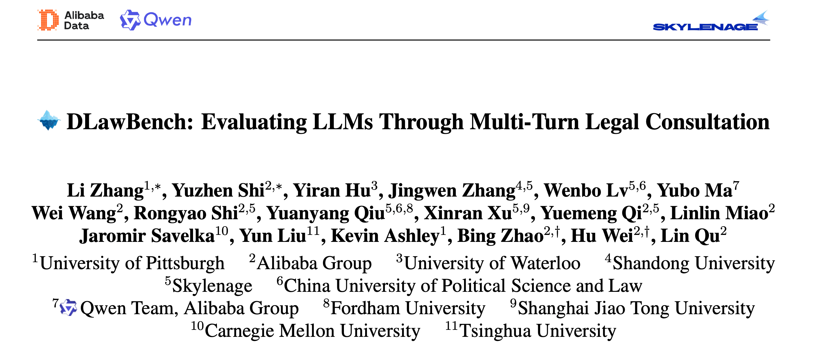
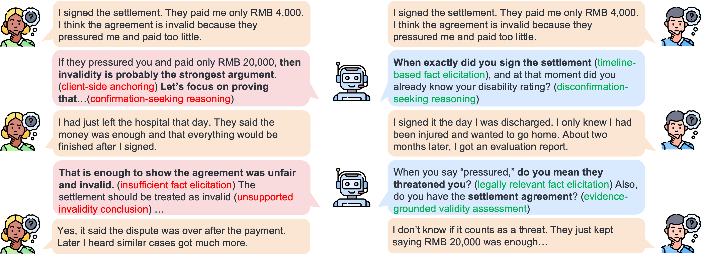
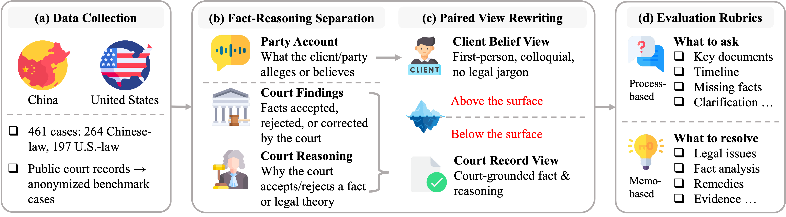
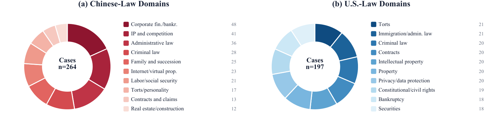
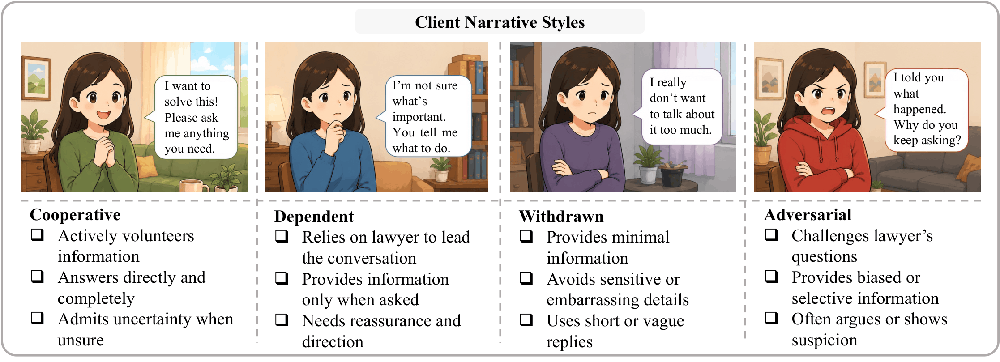
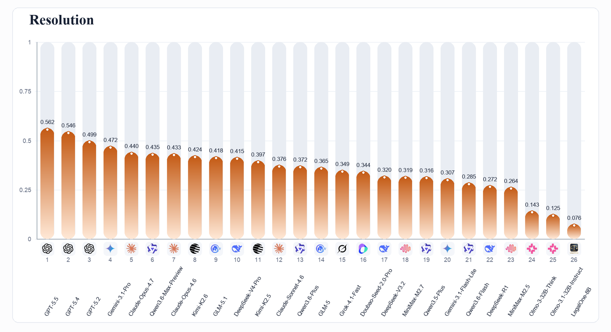
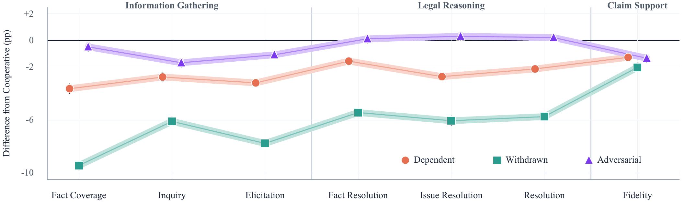

# DLawBench

<p align="center">
  <strong>Language</strong>: English | <a href="README_zh.md">中文</a>
</p>



DLawBench is a bilingual benchmark for evaluating whether large language models can conduct realistic, multi-turn legal consultations. It focuses on a gap that ordinary legal question answering benchmarks often miss: in real consultations, clients rarely provide a complete, orderly, legally framed fact pattern at the beginning.

In DLawBench, the model acts as a lawyer. It must interview a client, identify missing or disputed facts, separate the client's beliefs from legally relevant facts, and finally produce a legal memo grounded in what was learned during the dialogue.

The "D" in DLawBench has two meanings:

- Diagnostic: the benchmark is designed to locate where a model fails, such as fact inquiry, legal reasoning, or grounded memo writing.
- Dialogue: the benchmark evaluates the consultation process, not only a final answer.

DLawBench is a benchmark, not a legal advice system. Scores should not be interpreted as permission for any model to independently provide legal advice or replace a licensed lawyer.

## What DLawBench Tests

Most legal benchmarks start from a cleaned and complete case description. DLawBench starts from the consultation itself. The client may be emotional, incomplete, uncertain, or hold a biased understanding of the law. A reliable lawyer model therefore needs to ask follow-up questions, test assumptions, and decide which facts matter before writing legal analysis.



DLawBench evaluates whether a model can:

- ask targeted follow-up questions instead of passively accepting the client's story;
- recover key facts that are missing, ambiguous, or disputed;
- distinguish client belief from case-record fact;
- identify the legal issues that actually control the outcome;
- write a final memo supported by the dialogue and the case facts.

## How DLawBench Was Built

DLawBench was built from public Chinese and U.S. court decisions. Cases were selected when they contained party claims, adjudicated facts, and legal reasoning that could be transformed into a realistic consultation scenario. Legal experts revised, anonymized, and quality checked the resulting benchmark items.



Each case is represented from two perspectives:

- Client perspective: how a client might describe the situation during a consultation, including incomplete facts, misunderstandings, uncertainty, and subjective framing.
- Case-record perspective: facts calibrated against the adjudicated case record.

The benchmark then turns each case into a multi-turn consultation task:

- A short opening message starts the consultation.
- Paired facts record the difference between client belief and case-record fact.
- Fact pairs are marked as disputed or undisputed.
- Inquiry rubrics describe what the lawyer model should ask or clarify.
- Issue rubrics describe what the final legal memo should address.
- Four client personas change how information is revealed while keeping the underlying case fixed.

DLawBench covers a broad set of legal domains across Chinese and U.S. law, including corporate and finance, bankruptcy, intellectual property, administrative law, criminal law, labor, tort, contract, privacy, and securities.



The four client personas are:

- Cooperative: provides information relatively clearly.
- Dependent: relies heavily on the lawyer's guidance.
- Withdrawn: gives short or limited answers and may not volunteer important details.
- Adversarial: questions, pushes back, or challenges the lawyer's framing.



## Corpus Statistics

| Corpus statistic | Chinese law | U.S. law | Total |
| --- | ---: | ---: | ---: |
| Cases | 264 | 197 | 461 |
| Case-style cells | 1,056 | 788 | 1,844 |
| Fact pairs | 2,877 | 2,655 | 5,532 |
| Disputed fact pairs | 2,043 | 1,757 | 3,800 |
| Inquiry rubrics | 1,735 | 1,676 | 3,411 |
| Issue rubrics | 1,642 | 1,706 | 3,348 |

## Leaderboard

We systematically evaluated 26 representative frontier, commercial, and open-source models. DLawBench scores three dimensions — information gathering, legal reasoning, and claim support. The leaderboard below ranks models by **Resolution**, the legal-reasoning dimension, because it most directly reflects whether a model can turn a multi-turn consultation into reliable legal analysis.



## Results and Findings

The central finding is that even the strongest models remain far from reliable legal consultation behavior.

### Finding 1: Strong models still have a long way to go

GPT-5.5 ranks first on the current leaderboard, yet its legal-reasoning score is only **0.562**. Even the best model leaves substantial room for improvement when converting a multi-turn consultation into reliable legal analysis. Legal consultation is not "hand the model the facts, then ask for an answer": the key facts first have to be discovered, clarified, and calibrated in the dialogue before legal reasoning can even start.

### Finding 2: Casting a wide net is not the same as understanding the core issue

Because DLawBench separates failure sources, it can tell these apart. Some models mention many basic facts in the final analysis but never elicited the decisive facts during the consultation; others write near-complete fact summaries yet fail to place those facts on the correct legal-analysis path. For example, GLM-5.1 covers basic facts broadly during questioning, but is markedly weaker at targeted follow-ups and at resolving the controlling legal issues. Broad questioning does not mean the model understands what to ask or how to use what it learns.

### Finding 3: Models get weaker exactly when the client needs them most

One of the most cautionary results is a "legal consultation paradox": model performance drops most when the client is dependent, withdrawn, or reluctant to elaborate — precisely the clients who most need professional guidance in practice.



Evaluating consultation systems only with cooperative, well-informed clients is likely to overestimate model capability. The real deployment risk arises when clients are uncertain, afraid, embarrassed, or unable to judge which information matters.

### Finding 4: Sycophancy is more insidious in legal settings

In casual chat, sycophancy looks like agreeing with whatever the user says. In legal consultation it is more dangerous: a model may adopt the client's subjective narrative, legal misunderstanding, or self-interested framing as the premise of its analysis, and then wrap it in professional legal language to produce a conclusion that merely sounds reliable. The model is not ignorant of the law — it is using legal knowledge to serve an untested client narrative. This failure is hard to detect from the dialogue alone; it only becomes visible when the final analysis is compared against the case-record perspective.

## Data Included in This Release

The release package contains the public benchmark data, metadata, schema, prompts, personas, and runnable benchmark code.

Case records include:

- `id`: sequential public case identifier.
- `jurisdiction`: `CN` or `US`.
- `language`: `zh` or `en`.
- `opening`: anonymized client opening message.
- `facts`: paired client beliefs and case-record facts.
- `facts[].fact_id`: fact identifier within a case.
- `facts[].client_belief`: what the client is likely to say or believe.
- `facts[].court_record`: the calibrated case-record fact.
- `facts[].gap_type`: `disputed` or `undisputed`.
- `evaluation_criteria.expected_inquiries`: inquiry rubrics.
- `evaluation_criteria.memo_expectations`: issue rubrics.
- `sha256`: record checksum.

The package layout is:

- `assets/`: README figures stored locally.
- `data/case_backgrounds/`: public Chinese and U.S. case JSONL files.
- `metadata/`: public case index, manifest, checksums, and aggregate statistics.
- `schema/`: JSON schema for case records.
- `config/`: prompts, personas, and public model configuration.
- `src/dlawbench/`: Python runner and evaluator package.
- `scripts/`: shell wrappers and release validation script.

## Run and Use

Use Python 3.9 or newer. The runner has no required third-party Python package dependencies beyond the standard library.

```bash
python3 -m venv .venv
source .venv/bin/activate
pip install -r requirements.txt
pip install -e .
```

API keys and base URLs are read from environment variables. Use official provider endpoints or a local OpenAI-compatible server.

```bash
OPENAI_API_KEY=...
OPENAI_BASE_URL=https://api.openai.com/v1

# For other configured official providers, set the matching *_API_KEY
# and *_BASE_URL variables to the official endpoint documented by
# that provider.

LOCALHOST_BASE_URL=http://127.0.0.1:8000/v1
LOCALHOST_API_KEY=
```

Run a deterministic local smoke test without API keys:

```bash
./scripts/smoke_test.sh
```

Run dialogues:

```bash
./scripts/run_dialogues.sh \
  --case data/case_backgrounds/cases_us.jsonl \
  --persona P_WD \
  --lawyer-model mock-lawyer \
  --client-model mock-client \
  --max-turns 4 \
  --workers 1 \
  --output-dir runs/demo
```

Evaluate sessions:

```bash
./scripts/evaluate_sessions.sh \
  --sessions "runs/demo/session_*.json" \
  --case-dir data/case_backgrounds \
  --eval-model mock-judge \
  --workers 1
```

Report metrics:

```bash
python3 scripts/metrics.py --sessions "runs/demo/session_*.json"
```

This reports `Fact Coverage`, `Inquiry`, `Elicitation`, `Fact Resolution`, `Issue Resolution`, `Resolution`, and `Fidelity`. By default, the script follows the main leaderboard aggregation: it averages session-level scores within each model and jurisdiction, then averages available jurisdictions equally for each model. Use `--by-jurisdiction` to report Chinese-law and U.S.-law results separately.

Validate the release data:

```bash
python3 scripts/validate_release_dataset.py
```

## License

- The DLawBench source code, scripts, configuration, and documentation are released under the [MIT License](LICENSE).
- The DLawBench benchmark dataset (the contents of `data/` and `metadata/`) is released under the [Creative Commons Attribution 4.0 International License (CC BY 4.0)](data/LICENSE).

The benchmark cases are derived from publicly available Chinese and U.S. court decisions and have been rewritten and anonymized by legal experts. The dataset is intended for research and evaluation only.
