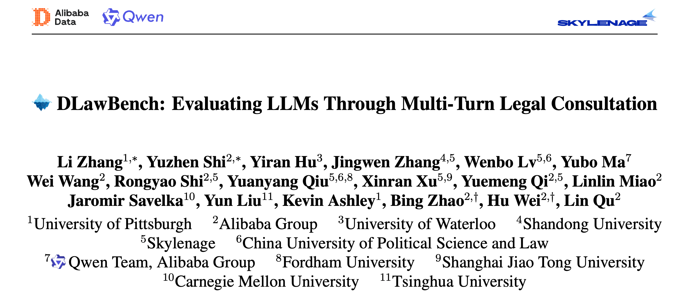
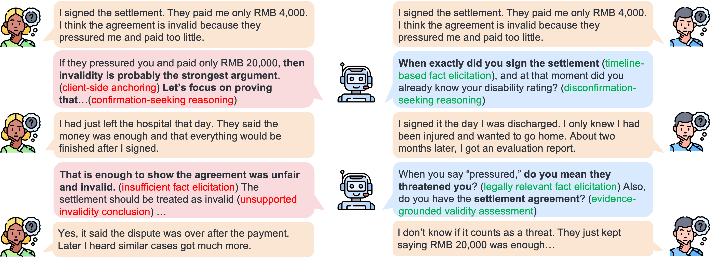
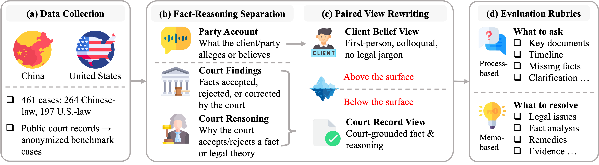
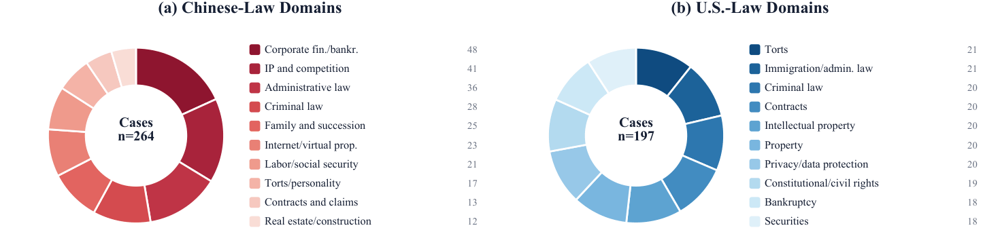
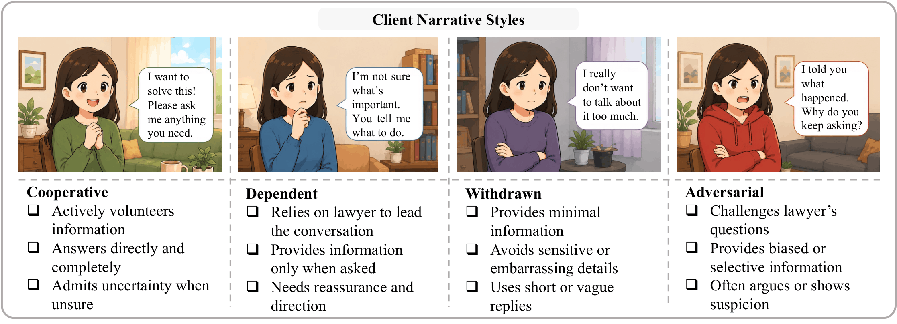
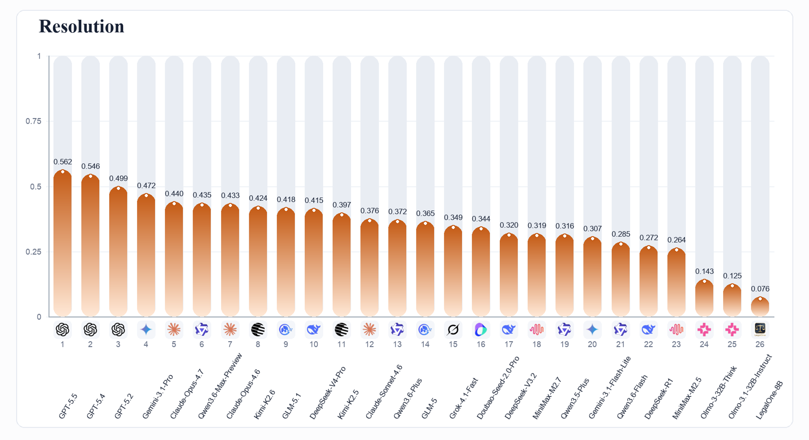
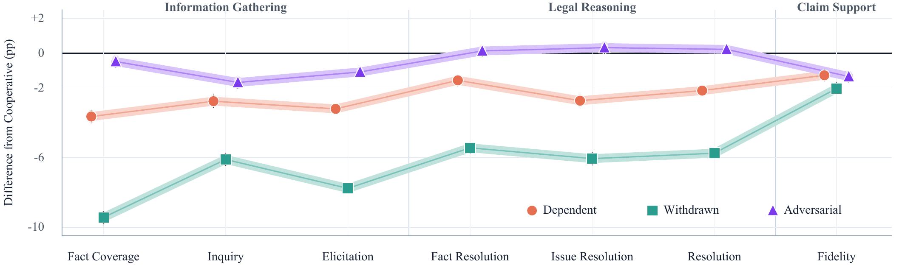

# DLawBench

**语言**：[English](README.md) | 中文



DLawBench 是一个面向真实法律咨询场景的双语多轮交互评测基准。它关注普通法律问答评测容易忽略的问题：真实当事人通常不会一开始就给出完整、清晰、法律化整理好的案情。

在 DLawBench 中，模型扮演律师，需要通过多轮对话接待客户、发现信息缺口、核实争议事实、区分当事人的主观理解与法律上可用的事实，并最终写出一份有事实支撑的法律分析备忘录。

DLawBench 中的 "D" 有两层含义：

- Diagnostic：评测不只给总分，而是帮助定位模型究竟失败在事实追问、法律推理，还是备忘录支撑。
- Dialogue：评测对象是一场完整咨询过程，而不只是最终答案。

DLawBench 是评测基准，不是法律咨询系统。任何模型分数都不应被解释为模型可以独立提供法律意见或替代持证律师。

## DLawBench 评测什么

多数法律评测从整理干净、事实完整的题目开始。DLawBench 从咨询本身开始。当事人可能带着情绪、不完整信息、不确定性或有偏差的法律理解进入咨询。可靠的律师模型必须先追问、核实和判断哪些事实真正重要，然后才能写出法律分析。



DLawBench 评测模型是否能够：

- 主动进行有针对性的追问，而不是被动接受当事人叙述；
- 找回缺失、模糊或存在争议的关键事实；
- 区分当事人主观理解与案件事实；
- 识别真正影响结论的法律问题；
- 写出由对话内容和案件事实支撑的最终备忘录。

## DLawBench 如何构造

DLawBench 基于中美公开裁判文书构建。我们筛选包含当事人主张、法院认定事实和法院推理的案件，并将其改写为接近真实咨询的多轮任务。数据经过法律专家修订、匿名化和质量检查。



每个案件同时保留两种视角：

- 当事人叙述视角：记录当事人在咨询中可能如何表达自己的经历、误解、不确定性和诉求。
- 案件事实视角：记录经过案件材料校准的事实情况。

随后，每个案件被组织成可运行的多轮咨询任务：

- 用一段客户开场白启动咨询。
- 用配对事实记录 "当事人理解" 与 "案件事实" 的差异。
- 将事实标记为有争议或无争议。
- 用追问 rubric 标注律师模型应当问清的问题。
- 用备忘录/issue rubric 标注最终法律分析应当覆盖的问题。
- 用四类客户画像改变信息披露方式，但不改变案件本身事实。

DLawBench 覆盖中美法律下的多个领域，包括公司金融、破产、知识产权、行政、刑事、劳动、侵权、合同、隐私、证券等。



四类客户画像包括：

- 配合型：愿意提供信息，表达相对清楚。
- 依赖型：很依赖律师引导，不确定哪些事实重要。
- 回避型：回答简短、克制，不主动展开。
- 对抗型：会质疑、反驳或挑战律师判断。



## 数据统计


| Corpus statistic    | Chinese law | U.S. law | Total |
| ------------------- | ----------- | -------- | ----- |
| Cases               | 264         | 197      | 461   |
| Case-style cells    | 1,056       | 788      | 1,844 |
| Fact pairs          | 2,877       | 2,655    | 5,532 |
| Disputed fact pairs | 2,043       | 1,757    | 3,800 |
| Inquiry rubrics     | 1,735       | 1,676    | 3,411 |
| Issue rubrics       | 1,642       | 1,706    | 3,348 |


## Leaderboard

我们对 26 个代表性的前沿模型、商业模型和开源模型进行了系统评测。DLawBench 同时考察信息收集、法律推理和结论支撑三个维度，下方排行榜按 **Resolution**（法律推理）排序，因为它最直接反映模型能否把一场多轮咨询转化为可靠法律分析。



## 结果与发现

核心结论是：即使最强模型也离可靠法律咨询仍有明显距离。

### 发现一：强模型仍有很大提升空间

在当前排行榜中，GPT-5.5 排名第一，但其法律推理得分只有 **0.562**。这说明，即使是表现最好的模型，在把多轮咨询转化为可靠法律分析时，仍然存在明显提升空间。换句话说，法律咨询不是"把事实交给模型，再让模型输出答案"这么简单。关键事实必须先在对话中被发现、澄清和校准，然后才能进入法律推理。

### 发现二：广撒网式提问，不等于理解核心问题

DLawBench 的诊断价值，在于它能拆开不同失败来源。有些模型能在最终分析里提到不少基本事实，却没有在咨询阶段追问出关键事实；也有模型能写出接近完整的事实总结，却没有把事实放到正确的法律分析路径上。例如，GLM-5.1 问询基本事实的覆盖面较广，但关键追问和法律问题解决能力明显更弱。这说明，模型**广撒网式**的问询，并不代表它真的理解该问什么、该如何使用这些事实。

### 发现三：模型在最需要帮助的客户面前反而变弱

最值得警惕的结果之一，是我们观察到一个"法律咨询悖论"：当客户更依赖、更沉默、更不愿展开时，模型性能下降最明显。而这些客户，恰恰往往是现实中最需要专业引导的人。



相对于配合型客户，依赖型和回避型客户显著拉低信息收集与法律推理表现；对抗型客户的影响反而更小。这意味着，如果只用配合、信息充分的理想客户来评测法律咨询系统，我们很可能会高估模型能力。真正的部署风险，往往发生在客户**不确定、害怕、羞于表达或无法判断哪些信息重要**的时候。

### 发现四：法律场景中的"迎合"更隐蔽

在普通聊天中，迎合可能表现为"用户说什么模型都倾向同意"。但在法律咨询中，迎合更危险，因为模型可能会把当事人的主观叙事、法律误解或利益诉求当作分析前提，再用专业法律语言为其包装出一个看似可靠的结论。换句话说，模型不是完全不懂法律；它可能是在用法律知识服务一个未经检验的当事人叙述。这类失败在单一视角评测中很难被发现，只有对照案件事实视角，才能看到模型是否真正检验了当事人叙述，还是只是把当事人想听的结论变成了一段法律分析。

## 数据集包含的信息

本 Release 包含公开 benchmark 数据、元数据、schema、prompt、客户画像和可运行代码。

案例记录包含：

- `id`：公开顺序编号。
- `jurisdiction`：`CN` 或 `US`。
- `language`：`zh` 或 `en`。
- `opening`：匿名化后的客户开场白。
- `facts`：当事人理解与案件事实的配对事实。
- `facts[].fact_id`：案件内事实编号。
- `facts[].client_belief`：客户可能表达或相信的内容。
- `facts[].court_record`：经过校准的案件事实。
- `facts[].gap_type`：`disputed` 或 `undisputed`。
- `evaluation_criteria.expected_inquiries`：追问 rubric。
- `evaluation_criteria.memo_expectations`：备忘录/issue rubric。
- `sha256`：记录校验哈希。

目录结构：

- `assets/`：README 使用的本地图片。
- `data/case_backgrounds/`：公开的中国法和美国法案例 JSONL。
- `metadata/`：公开案例索引、manifest、校验哈希和汇总统计。
- `schema/`：案例记录 JSON schema。
- `config/`：prompt、客户画像和公开模型配置。
- `src/dlawbench/`：Python 运行与评测包。
- `scripts/`：shell 包装脚本和 Release 数据校验脚本。

## 运行与使用

使用 Python 3.9 或更新版本。运行器除 Python 标准库外没有必需的第三方依赖。

```bash
python3 -m venv .venv
source .venv/bin/activate
pip install -r requirements.txt
pip install -e .
```

API key 和 base URL 从环境变量读取。请使用官方 API endpoint，或使用本地 OpenAI-compatible 服务。

```bash
OPENAI_API_KEY=...
OPENAI_BASE_URL=https://api.openai.com/v1

# 其他已配置的官方 provider，请设置对应的 *_API_KEY
# 和 *_BASE_URL，并使用该 provider 文档中的官方 endpoint。

LOCALHOST_BASE_URL=http://127.0.0.1:8000/v1
LOCALHOST_API_KEY=
```

无需 API key 的确定性本地 smoke test：

```bash
./scripts/smoke_test.sh
```

运行对话：

```bash
./scripts/run_dialogues.sh \
  --case data/case_backgrounds/cases_us.jsonl \
  --persona P_WD \
  --lawyer-model mock-lawyer \
  --client-model mock-client \
  --max-turns 4 \
  --workers 1 \
  --output-dir runs/demo
```

评测 session：

```bash
./scripts/evaluate_sessions.sh \
  --sessions "runs/demo/session_*.json" \
  --case-dir data/case_backgrounds \
  --eval-model mock-judge \
  --workers 1
```

输出指标：

```bash
python3 scripts/metrics.py --sessions "runs/demo/session_*.json"
```

该脚本报告指标：`Fact Coverage`、`Inquiry`、`Elicitation`、`Fact Resolution`、`Issue Resolution`、`Resolution` 和 `Fidelity`。默认聚合方式与正文 leaderboard 一致：先在同一模型、同一 jurisdiction 内对 session 求均值，再对每个模型的可用 jurisdiction 等权平均。使用 `--by-jurisdiction` 可以分别输出中国法和美国法结果。

校验 Release 数据：

```bash
python3 scripts/validate_release_dataset.py
```

## 许可证

- DLawBench 源代码、脚本、配置和文档在 [MIT License](LICENSE) 下发布。
- DLawBench 数据集（`data/` 与 `metadata/` 目录内容）在 [CC BY 4.0（署名 4.0 国际）](data/LICENSE) 许可下发布。

benchmark 案例改编自中美公开裁判文书，并经法律专家改写和匿名化处理，仅用于研究与评测目的。